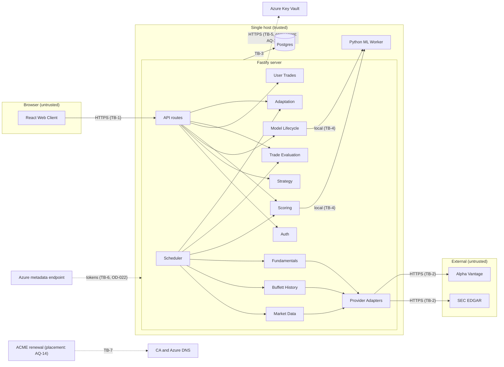
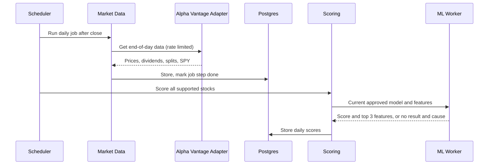
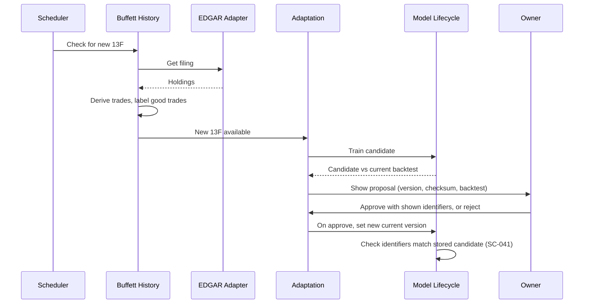
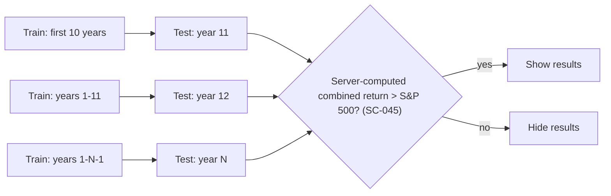

# ARCHITECTURE

Owns HOW the system is built: components, interfaces, data flows, trust boundaries, and technology choices with their rationale. Behavior: `REQUIREMENTS.md`. Visual and frontend rules: `DESIGN.md`. Security controls and their configuration values: `SECURITY.md`.

## Required Architecture Inputs

| Field | Value |
|---|---|
| Requirements source | `REQUIREMENTS.md` |
| Design source | `DESIGN.md` |
| Target surfaces | Desktop web browser (NFR-1, NFR-7) |
| Runtime and deployment environment | One Azure VM running Docker. Three containers: Fastify server (Node.js 26), Python ML worker (Python 3.13), Postgres. The server and Postgres share one internal Docker network. The worker is attached to no network and is reached only through the Unix socket (SC-048). Minimum VM: 4 CPU cores, 8 GB RAM, no GPU. VM size: Azure `Standard_D4s_v5` (4 vCPU, 16 GB RAM) with a 256 GB Premium SSD data disk, which leaves headroom for Postgres and ML training |
| Server framework | Fastify 5.12 on Node.js 26, written in TypeScript 7. Validation: Zod 4. Data access: Prisma 7.10 |
| Client framework(s) | React 19, written in TypeScript 7. Patch level: SC-027 |
| API style and integration model | JSON REST over HTTPS, same origin, served by Fastify. Outbound HTTPS pull from SEC EDGAR and Alpha Vantage. No broker (FR-3.9) |
| Authentication and session model | One owner account with password login (FR-6.1, FR-6.2). Server-side sessions stored in Postgres and carried by a cookie. The account is created by a server CLI command run in the server container (FR-6.3). Password change and logout are in the UI (FR-6.4, FR-6.5). Hashing, cookie, timeout, and rate-limit controls: `SECURITY.md` |
| Data model and scale expectations | One user. Stock coverage per FR-1.1 and price history per FR-1.4. The stock list is not fixed. It is rebuilt each day from the Alpha Vantage `LISTING_STATUS` endpoint, filtered to active common stocks on the three exchanges (about 5,000 to 6,000 today). Capacity is sized for up to 8,000 stocks |
| Security expectations | NFR-5, NFR-6. Controls: `SECURITY.md` |

### Notes on developer inputs

- **N-1:** Inputs listed Node.js as the framework and Fastify as the runtime. Fastify is the framework and Node.js is the runtime.
- **N-2:** A local Mistral model was requested. A language model cannot be the trade model (FR-3.3 is a tabular learning task), and no requirement asks for generated text. Owner decision: no language model. The feature reasons for FR-3.7 come straight from the trade model.

## Architecture and Decisions

- **Overall shape:** one modular monolith (one Fastify process), Postgres, and one local Python ML worker. No microservices or message brokers; one user does not need them.
- **Client:** React single-page app, built to static files and served by Fastify.
- **API:** request contracts are Zod 4 schemas, which Fastify applies through a Zod validator compiler (`setValidatorCompiler`). Zod schemas are the single source of request contracts. Validation rules: SC-007, SC-008.
- **Persistence:** Postgres is the only database. It holds all entities, job state, and model version metadata. Trained model files are on local disk, with a checksum and version stored in Postgres. The worker writes new model files to a staging directory. Model Lifecycle computes the checksum, promotes the file to a directory that the worker can only read, and records the checksum (SC-044). Protection of trade-derived model files and of backups is open (OD-021). User trade data uses envelope encryption in the server (NFR-5): a data key encrypts the fields, and a key in Azure Key Vault wraps the data key. Encryption controls: SC-015.
- **Scheduling:** a scheduler inside the server process, with job state in Postgres. Jobs are idempotent and resume after a restart (NFR-4). Jobs: daily end-of-day update and scoring (FR-1.3, FR-3.6), 13F check (FR-2.3), quarterly evaluation and proposal (FR-4.4, FR-5.2). If Azure Key Vault cannot be reached, jobs that need trade data fail and retry. Other jobs continue. This conflicts with the SC-028 startup rule during a restart; the conflict is held open in OD-026 (CF-001). Daily scoring uses data for one trading day only and records whether the day is complete (FR-3.12, FR-3.13); the trading-calendar source is open (AQ-16). Scheduler jobs and the 13F hand-off create candidates and proposals only, one proposal per 13F accession number (DR-11, SC-043). At most one training job runs at a time, and the daily job has priority (SC-057).
- **Trade model:** gradient-boosted decision trees on tabular stock features, built with LightGBM in the Python worker. They train on a CPU, work with small labeled sets, and give per-feature effects for the reason (FR-3.7). Models are saved with `save_model` in LightGBM's text format and loaded with `Booster(model_file=...)`. Model-file controls: SC-021.
- **ML worker:** a separate Python 3.13 container on the same VM. The server reaches it through a Unix domain socket on a shared Docker volume, with length-prefixed JSON messages. It trains, backtests, and scores. It owns no business rules and stores nothing in Postgres directly. Every server call to the worker has a deadline; the values and the worker resource limits are open (OD-028). Socket and message controls: SC-019, SC-020.
- **Backtest:** the ML worker runs the walk-forward backtest that FR-3.4 and FR-3.4.1 define and returns per-test-year returns. Model Lifecycle computes the combined return and applies the FR-3.5 gate against the SPY series that Market Data owns (FR-3.5.1, SC-045).
- **Proposals (FR-5.1):** the candidate model trains on Buffett good trades plus the owner's examined trades as extra labeled examples, with equal weight per example. The strategy feature weights are refit from the candidate model.
- **Market data and features:** Alpha Vantage on a paid plan for end-of-day prices, dividends, and splits. Plan: Alpha Vantage Premium at 75 requests per minute (about US$50 a month; recheck the price at signup). The daily update needs one request per stock, so 8,000 stocks take about 107 minutes, inside the NFR-2 limit. The one-time history backfill runs over several nights. The free tier (25 requests a day) is too small. Fundamental features (P/E, return on equity, debt, earnings stability) come from SEC EDGAR company financial data (XBRL), using the existing EDGAR integration.
- **Provider requests:** Provider Adapters retry failed requests with backoff. Deadline and response-size controls: SC-017.
- **S&P 500 baseline:** total return from SPY adjusted daily prices (price plus dividends) from Alpha Vantage. Decision: SPY total return is the index proxy. It tracks the S&P 500 closely, and its small fee drag (0.0945% a year) makes the baseline slightly easier to beat; FR-3.11 makes the system state this to the user. SPY is used only as an internal benchmark and is never shown as a supported stock, so FR-1.1 still holds.

## Security-Related Technology

Technology that the controls in `SECURITY.md` configure. Source: owner interviews, 2026-10-30 (OD-017).

- **TLS and certificates:** Fastify serves HTTPS directly, with no reverse proxy, using a public CA certificate. There is no port 80 listener (SC-030), so certificate renewal uses the ACME DNS-01 challenge against an Azure DNS zone, authenticated with the VM's managed identity. The component that runs the ACME client is open (AQ-14). The Postgres hop uses a certificate from a private CA. The Unix socket to the worker is not a network hop.
- **Azure Key Vault:** holds the application secrets and the key that wraps the trade-data key. The server authenticates to it with the VM's managed identity. Client libraries: `@azure/identity` (`ManagedIdentityCredential`), `@azure/keyvault-secrets`, and `@azure/keyvault-keys`, newest versions, pinned in the lockfile (AQ-15). The owning component and its trust boundary are open (AQ-13).
- **Session, CSRF, and rate-limit plugins:** `@fastify/cookie`, `@fastify/session` with a Postgres-backed store, `@fastify/csrf-protection`, and `@fastify/rate-limit`. Configuration: SC-002, SC-005, SC-006.
- **13F XML parser:** `fast-xml-parser`, newest version. Parser settings: SC-038.
- **CI:** GitHub Actions runs type checks, grep checks, and Trivy image scans (SC-034).

## Components and Flows

| Component | Responsibility | Business rules enforced | Data owned | Requirements | Status |
|---|---|---|---|---|---|
| Web Client (React) | Show views from `DESIGN.md`. Enter and import trades. Approve proposals. Restore versions | None (presentation only) | None | NFR-1, NFR-3, NFR-7, NFR-8, FR-7.1 | SUPPORTED |
| API (Fastify routes) | HTTPS endpoints, schema checks, session check | Login before use | None | FR-6.2, NFR-5 | SUPPORTED |
| Auth | Password check, session lifecycle | One account, one owner role | Account, Session | FR-6.1, FR-6.2, NFR-5 | SUPPORTED |
| Market Data | Get end-of-day prices, dividends, splits, and SPY baseline. Filter to US common stocks. Hold implausible records for review | Coverage and USD only. Rate limits. Plausibility checks (SC-056) | US stock, End-of-day market data, Benchmark series | FR-1.1–1.5, FR-7.2, NFR-2 | SUPPORTED |
| Buffett History | Get 13F filings and 13F/A amendments. Derive buy/add/reduce/sell. Label good trades | 13F delta rule. Amendment rule (OQ-15). Good-trade rule. Plausibility checks (SC-056) | 13F filing, Buffett historical trade, Good trade | FR-2.1–2.5, FR-7.2 | SUPPORTED |
| Fundamentals | Get company financial data from EDGAR. Compute stock features | Feature definitions | Stock features | FR-1.5, FR-3.2 | SUPPORTED |
| Strategy | Readable rules and feature weights. Versions | Strategy is separate from the model | Strategy, Strategy version | FR-3.1, FR-3.2, FR-5.5, FR-5.6 | SUPPORTED |
| Model Lifecycle | Train, walk-forward backtest, gate, version, restore. Compute and record model checksums | Must beat S&P 500 (gate computed on the server). Approved version only, bound to the displayed candidate. Restore only to approved, gate-passed previous versions | Trade model, Model version, Backtest result | FR-3.3–3.5, FR-5.5–5.7 | SUPPORTED |
| Scoring | Daily score, buy/hold/sell, top 3 features, "No result" with cause | Thresholds. Current approved model only. Never trades | Daily score | FR-3.6–3.9, FR-5.7 | SUPPORTED |
| User Trades | Manual entry, CSV import, encryption at rest | Required fields. Data stays local | User trade | FR-4.1, FR-4.2, NFR-5, NFR-6 | SUPPORTED |
| Trade Evaluation | Close-time and quarterly success checks | Success rule against S&P 500 | Trade success result | FR-4.3–4.5 | SUPPORTED |
| Adaptation | Build proposals. Compare backtests. Apply only after approval | No change without approval | Proposal | FR-5.1–5.4, FR-5.7 | SUPPORTED |
| Scheduler | Run and resume daily and quarterly jobs | Idempotent, restart-safe | Job run | FR-1.3, FR-2.3, FR-4.4, FR-5.2, NFR-2, NFR-4 | SUPPORTED |
| ML Worker (Python, local) | Train, backtest, and score on request | None | Model files on disk | FR-3.3, FR-3.4, FR-3.6, NFR-6 | SUPPORTED |
| Provider Adapters | SEC EDGAR client, Alpha Vantage client | Request limits, terms of use | None | FR-1.3, FR-2.3, FR-7.2 | SUPPORTED |

### Main data flows

1. **Daily update:** Scheduler → Market Data (Alpha Vantage adapter) → Postgres → Scoring → ML Worker → daily scores (NFR-2).
2. **13F ingest:** Scheduler → Buffett History (EDGAR adapter) → derive trades → label good trades → Fundamentals refresh → Adaptation (FR-5.2).
3. **Train and gate:** Model Lifecycle reads Strategy, good trades, features, and prices → ML Worker runs the walk-forward backtest → results shown only if the gate passes (FR-3.4, FR-3.5).
4. **User trade evaluation:** Client → User Trades (encrypted) → Trade Evaluation on close or each quarter → success result.
5. **Adaptation:** success results plus new 13F data → candidate strategy and model → backtest compare → owner approves → new current version (FR-5.4, FR-5.7). Restore makes an earlier version current (FR-5.6).

### Trust boundaries

The controls for each boundary are in `SECURITY.md`. Each rule cites the boundary it enforces.

- **TB-1 Browser ↔ Server:** HTTPS, terminated by Fastify itself. Requests are untrusted until the session and schema checks pass.
- **TB-2 Server ↔ External providers (SEC EDGAR, Alpha Vantage):** outbound only. Responses are untrusted. No user trade data crosses this boundary (NFR-6).
- **TB-3 Server ↔ Postgres:** separate containers on one internal Docker network, connected by TLS with a private CA certificate.
- **TB-4 Server ↔ ML Worker:** Unix domain socket on a shared volume. It is not a network connection. The worker has no network (SC-048).
- **TB-5 Server ↔ Azure Key Vault:** outbound HTTPS for secrets and for key wrap and unwrap. The owning component and the wrapped-key storage are open (AQ-13). Only the data key crosses this boundary (SC-016).
- **TB-6 Containers ↔ Azure instance metadata endpoint and control plane:** managed-identity tokens come from the VM metadata endpoint. Which containers can reach it, and the identity scope, are open (OD-022). Azure subscription roles are a separate path to the VM, disks, and Key Vault (OD-029).
- **TB-7 Certificate renewal ↔ certificate authority and Azure DNS:** outbound ACME DNS-01 calls. The component and its outbound authority are open (AQ-14, OD-023).
- **TB-8 CI ↔ image registry ↔ VM:** GitHub Actions builds and scans images (SC-034). The registry, deployment path, and signing are open (AQ-15, AQ-17, OD-030).
- **TB-9 Operator ↔ host:** shell, `docker exec`, and host CLI commands (FR-6.3, FR-6.6). Operator access is open (OD-029).

## Dependency Rules

- **DR-1:** Web Client depends only on the API. It has no business rules and no direct access to data or providers.
- **DR-2:** API routes depend on domain modules. Domain modules never depend on API routes or HTTP types.
- **DR-3:** Each entity has one owning module (table above). Other modules read it through that module's interface and never write its tables.
- **DR-4:** Domain modules depend on adapter interfaces (providers, ML Worker, storage). Vendor-specific code lives only in adapters.
- **DR-5:** Data flows one way: Market Data, Buffett History, and Fundamentals → Model Lifecycle → Scoring. User Trades → Trade Evaluation → Adaptation → Model Lifecycle and Strategy. No module calls back upstream.
- **DR-6:** Scheduler calls domain modules. Domain modules never call the Scheduler.
- **DR-7:** Only Model Lifecycle changes the current model and strategy versions, and only after owner approval or restore.
- **DR-8:** Adapters do not depend on each other. No circular dependencies between modules.
- **DR-9:** Only Model Lifecycle writes the strategy version, model version, and current-version tables. A build check enforces this (SC-039). Database privileges are open (SC-040, OD-020).
- **DR-10:** Only User Trades, Trade Evaluation, and Adaptation call trade-data decryption (SC-052; component open: AQ-13).
- **DR-11:** Scheduler jobs and event handlers create candidates and proposals only. They never call the operation that sets the current version (SC-043).

## Diagrams

### Components and trust boundaries



The worker is attached to no network (SC-048). Dotted lines are boundaries whose owner or controls are open.

### Daily update



### 13F ingest and adaptation



### Walk-forward backtest



### Version states

```mermaid
stateDiagram-v2
  [*] --> Candidate
  Candidate --> Rejected: fails gate or owner rejects
  Candidate --> Current: owner approves the displayed candidate (SC-041)
  Current --> Previous: newer version approved
  Previous --> Current: owner restores; approved before, gate passed, checksum matches (SC-042)
  Rejected --> [*]
```

## Open Questions

- **AQ-13:** Key Vault component and trust boundary. The server uses Azure Key Vault for secrets and for the key that wraps the trade-data key, but the Components table, DR-4, the trust boundaries, and the component diagram list no component or boundary for it. `SECURITY.md` names an "encryption adapter" (SC-015) and a "Key Vault adapter" (SC-016). To decide: the component that owns the Azure SDK client and envelope encryption, where the wrapped data key is stored, and the trust boundary for Server ↔ Azure Key Vault. TO BE DECIDED.
- **AQ-14:** ACME client placement. Certificate renewal uses ACME DNS-01 against Azure DNS ("TLS and certificates"), but no component runs the ACME client. SC-016 lets only Provider Adapters and the Key Vault adapter make outbound calls, and SC-017 limits Provider Adapters to SEC EDGAR and Alpha Vantage, so renewal calls from the server to the certificate authority and Azure DNS conflict with SC-016. To decide: which component runs the ACME client, and whether SC-016 must allow its outbound calls. TO BE DECIDED.
- **AQ-15:** Package manager and lockfile policy. `AGENTS.md` lists package managers and lockfile policy as TO BE DECIDED, but SC-032 requires `npm ci --omit=dev`, SC-027 verifies with `npm ls`, and "Azure Key Vault" requires versions pinned in the lockfile. To decide: the package manager and lockfile policy for the server, client, and worker. TO BE DECIDED.
- **AQ-16:** Trading-calendar source. FR-3.12 and FR-3.13 need the trading day for each data set, and the Scheduler needs to know when a day is complete (T-024). To decide: the source of US market trading days and holidays, inside the listed providers or as a fixed list. TO BE DECIDED.
- **AQ-17:** Image registry and deployment path. "CI" names GitHub Actions and Trivy but no registry and no path from CI to the VM (T-020, TB-8). To decide: the registry, the deploy mechanism, and its credentials. TO BE DECIDED.
