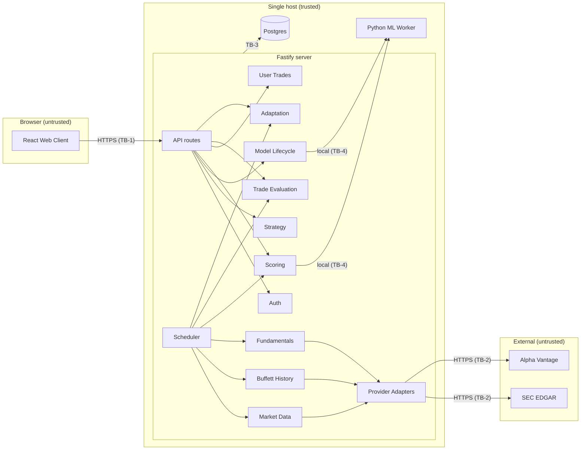
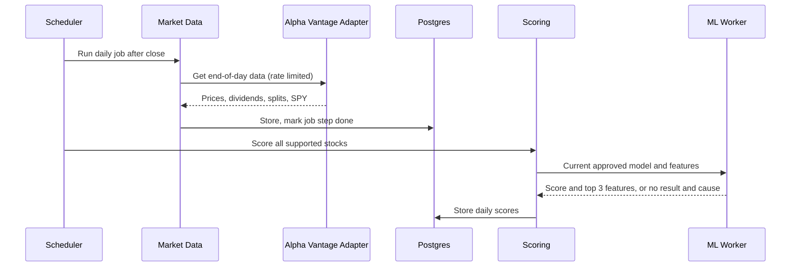
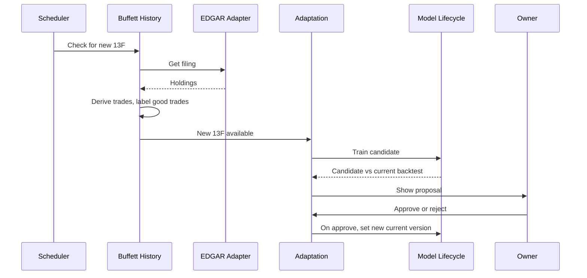
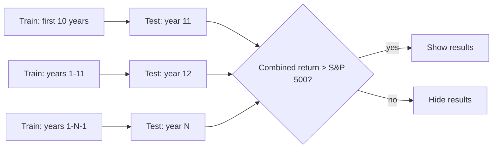
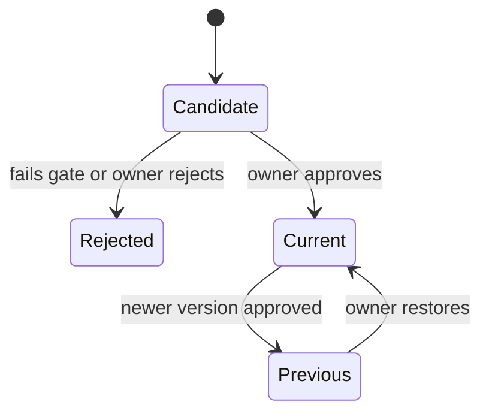

# ARCHITECTURE

Owns HOW the system is built. Behavior: `REQUIREMENTS.md`. Visual and frontend rules: `DESIGN.md`. Security controls: `SECURITY.md`.

## Required Architecture Inputs

| Field | Value |
|---|---|
| Requirements source | `REQUIREMENTS.md` |
| Design source | `DESIGN.md` |
| Target surfaces | Desktop web browser, window 1024px or wider (NFR-1, NFR-7) |
| Runtime and deployment environment | One Azure VM running Docker. Three containers on one internal Docker network: Fastify server (Node.js 26), Python ML worker (Python 3.13), Postgres. Minimum VM: 4 CPU cores, 8 GB RAM, no GPU (PROPOSED). VM size: UNKNOWN |
| Server framework | Fastify 5.12 on Node.js 26, written in TypeScript 7. Validation: Zod 4. Data access: Prisma 7.10 |
| Client framework(s) | React 19 (newest 19.x minor and patch), written in TypeScript 7 |
| API style and integration model | JSON REST over HTTPS, same origin, served by Fastify. Outbound HTTPS pull from SEC EDGAR and Alpha Vantage. No broker (FR-3.9) |
| Authentication and session model | One owner account, password login with Argon2id (FR-6.1, FR-6.2, NFR-5). Server-side session in Postgres with a secure HTTP-only cookie: 30-minute idle timeout, 8-hour maximum. Account created by a host command; password change and logout in the UI (FR-6.3–6.5) |
| Data model and scale expectations | One user. US common stocks on NYSE, NASDAQ, NYSE American, with daily history from the first 13F trade to now (FR-1.1, FR-1.4). Exact stock count: UNKNOWN (ASSUMPTION: about 5,000) |
| Security expectations | HTTPS, encrypted user trade data at rest, salted password hashes, no user trade data sent outside (NFR-5, NFR-6). TLS on every network hop with no plain HTTP listener (NFR-5). Detailed controls in `SECURITY.md` |

### Notes on developer inputs

- **N-1:** Inputs listed Node.js as the framework and Fastify as the runtime. Fastify is the framework and Node.js is the runtime.
- **N-2:** A local Mistral model was requested. A language model cannot be the trade model (FR-3.3 is a tabular learning task), and no requirement asks for generated text. Owner decision: no language model. The feature reasons for FR-3.7 come straight from the trade model.

## Architecture and Decisions

- **Overall shape:** one modular monolith (one Fastify process), Postgres, and one local Python ML worker. No microservices or message brokers; one user does not need them.
- **Client:** React single-page app, built to static files and served by Fastify. It holds no business rules.
- **API:** REST with JSON. Fastify validates every request part (params, querystring, headers, body) through a Zod 4 validator compiler (`setValidatorCompiler`). Zod schemas are the single source of request contracts.
- **Persistence:** Postgres is the only database. It holds all entities, job state, and model version metadata. Trained model files are on local disk, with a checksum and version stored in Postgres. User trade data is encrypted at rest (NFR-5) with envelope encryption: a data key encrypts the fields in the server, and an Azure Key Vault key wraps the data key. Details in "Security-relevant decisions".
- **Scheduling:** a scheduler inside the server process, with job state in Postgres. Jobs are idempotent and resume after a restart (NFR-4). Jobs: daily end-of-day update and scoring (FR-1.3, FR-3.6), 13F check (FR-2.3), quarterly evaluation and proposal (FR-4.4, FR-5.2).
- **Trade model:** gradient-boosted decision trees on tabular stock features, trained in the Python worker. They train on a CPU, work with small labeled sets, and give per-feature effects for the reason (FR-3.7).
- **ML worker:** a separate Python 3.13 container on the same VM, reachable only from the server through a Unix domain socket on a shared Docker volume. It trains, backtests, and scores. It owns no business rules and stores nothing in Postgres directly.
- **Backtest (FR-3.4):** rolling walk-forward test. Train on all years before year N, test on year N, then move forward one year. The minimum first training window is 10 years. The gate (FR-3.5) compares the combined test-period total return to the S&P 500 total return.
- **Score output (FR-3.7):** score 70–100 is buy, 31–69 is hold, 0–30 is sell. The reason shows the top 3 features.
- **Proposals (FR-5.1):** the candidate model trains on Buffett good trades plus the owner's examined trades as extra labeled examples, with equal weight per example. The strategy feature weights are refit from the candidate model.
- **Market data and features:** Alpha Vantage on a paid plan for end-of-day prices, dividends, and splits. Plan and cost: UNKNOWN. The free tier is too small for the full stock list in 2 hours (NFR-2). Fundamental features (P/E, return on equity, debt, earnings stability) come from SEC EDGAR company financial data (XBRL), using the existing EDGAR integration.
- **S&P 500 baseline:** total return from SPY adjusted daily prices (price plus dividends) from Alpha Vantage. ASSUMPTION: this is an acceptable proxy for the index. SPY is used only as an internal benchmark and is never shown as a supported stock, so FR-1.1 still holds.
- **CSV import (FR-4.2):** one header row and columns `symbol, side, date, quantity, price`. `side` is `buy` or `sell`, `date` is `YYYY-MM-DD`, and `price` is in USD. The import rejects the whole file if any row is not valid.

## Security-relevant decisions

Source: owner interviews, 2026-10-30. Values the assistant first proposed at the owner's request were reviewed and confirmed by the owner on 2026-10-30.

- **TLS everywhere:** Fastify serves HTTPS directly with a public CA certificate. There is no port 80 listener, so certificate renewal uses the ACME DNS-01 challenge against an Azure DNS zone, authenticated with the VM's managed identity. The Postgres hop uses a private CA certificate, checked with `sslmode=verify-full` and `sslrootcert`. The Unix socket to the worker is not a network hop.
- **Trade data encryption:** envelope encryption. AES-256-GCM data key in the server. Azure Key Vault key wraps and unwraps the data key. The server authenticates to Key Vault with the VM's managed identity. Encrypted fields: all user trade fields (symbol, side, date, quantity, price) and trade success results. Key Vault rotation policy: rotate the wrapping key yearly and rewrap the data key. If Key Vault cannot be reached, jobs that need trade data fail and retry. Other jobs continue (NFR-4).
- **Secrets:** the DB password, Alpha Vantage API key, session secret, and CSRF key live in Azure Key Vault. The server reads them at startup with the managed identity. No secrets in images, env files, or the repository.
- **Session and CSRF:** `@fastify/cookie` and `@fastify/session` with a Postgres-backed store. Cookie `__Host-` prefix, `Secure`, `HttpOnly`, `SameSite=Strict`. `@fastify/csrf-protection` in session mode with a header token on every state-changing route.
- **Login rate limit:** `@fastify/rate-limit` on the login route: 5 attempts per 15 minutes per client IP, plus 20 failed attempts per hour across the account. In-memory store; there is one server instance.
- **Input limits:** JSON API body 64 KiB. CSV import as a `text/csv` body of at most 1 MiB and 10,000 data rows. Provider responses at most 50 MiB each.
- **Account lifecycle:** the owner creates the one account with a server CLI command run in the container. The command refuses to run if an account exists. Password minimum length 15 characters. Password change needs the current password and ends all other sessions. Logout destroys the server session.
- **Model files:** stored in a non-executable model format (no pickle). SHA-256 checksum stored in Postgres. The worker verifies the checksum before it loads a model.
- **ML worker protocol:** length-prefixed JSON messages over the Unix socket, validated on both sides. Socket file mode 0660, owned by a group shared only by the server and worker containers.
- **Azure SDK:** `@azure/identity` (`ManagedIdentityCredential`), `@azure/keyvault-secrets`, and `@azure/keyvault-keys`, newest versions, pinned in the lockfile.
- **Timeouts and message size:** Fastify `connectionTimeout` 10 s, `requestTimeout` 30 s, `handlerTimeout` 25 s. Provider fetch deadline 60 s per request, retried with backoff. Worker socket message cap 16 MiB.
- **13F XML parser:** `fast-xml-parser`, newest version, with `processEntities: false` and no DTD support. Input size is capped by the 50 MiB provider response limit. A post-parse check rejects nesting deeper than 32 levels.
- **ML library and model format:** LightGBM. Models are saved with `save_model` in LightGBM's text format and loaded with `Booster(model_file=...)`. No pickle or joblib.
- **CI:** GitHub Actions runs type checks, grep checks, and Trivy image scans. A high or critical finding fails the build.
- **Containers:** multi-stage Dockerfiles, base images pinned by digest, non-root numeric users, read-only root filesystems. Image scanning in the build fails on high or critical findings.

## Components and Flows

| Component | Responsibility | Business rules enforced | Data owned | Requirements | Status |
|---|---|---|---|---|---|
| Web Client (React) | Show views from `DESIGN.md`. Enter and import trades. Approve proposals. Restore versions | None (presentation only) | None | NFR-1, NFR-3, NFR-7, NFR-8, FR-7.1 | SUPPORTED |
| API (Fastify routes) | HTTPS endpoints, schema checks, session check | Login before use | None | FR-6.2, NFR-5 | SUPPORTED |
| Auth | Password check, session lifecycle | One account, one owner role | Account, Session | FR-6.1, FR-6.2, NFR-5 | SUPPORTED |
| Market Data | Get end-of-day prices, dividends, splits, and SPY baseline. Filter to US common stocks | Coverage and USD only. Rate limits | US stock, End-of-day market data, Benchmark series | FR-1.1–1.5, FR-7.2, NFR-2 | SUPPORTED |
| Buffett History | Get 13F filings. Derive buy/add/reduce/sell. Label good trades | 13F delta rule. Good-trade rule | 13F filing, Buffett historical trade, Good trade | FR-2.1–2.5, FR-7.2 | SUPPORTED |
| Fundamentals | Get company financial data from EDGAR. Compute stock features | Feature definitions | Stock features | FR-1.5, FR-3.2 | SUPPORTED |
| Strategy | Readable rules and feature weights. Versions | Strategy is separate from the model | Strategy, Strategy version | FR-3.1, FR-3.2, FR-5.5, FR-5.6 | SUPPORTED |
| Model Lifecycle | Train, walk-forward backtest, gate, version, restore | Must beat S&P 500. Approved version only | Trade model, Model version, Backtest result | FR-3.3–3.5, FR-5.5–5.7 | SUPPORTED |
| Scoring | Daily score, buy/hold/sell, top 3 features, "No result" with cause | Thresholds. Current approved model only. Never trades | Daily score | FR-3.6–3.9, FR-5.7 | SUPPORTED |
| User Trades | Manual entry, CSV import, encryption at rest | Required fields. Data stays local | User trade | FR-4.1, FR-4.2, NFR-5, NFR-6 | SUPPORTED |
| Trade Evaluation | Close-time and quarterly success checks | Success rule against S&P 500 | Trade success result | FR-4.3–4.5 | SUPPORTED |
| Adaptation | Build proposals. Compare backtests. Apply only after approval | No change without approval | Proposal | FR-5.1–5.4, FR-5.7 | SUPPORTED |
| Scheduler | Run and resume daily and quarterly jobs | Idempotent, restart-safe | Job run | FR-1.3, FR-2.3, FR-4.4, FR-5.2, NFR-2, NFR-4 | SUPPORTED |
| ML Worker (Python, local) | Train, backtest, and score on request | None | Model files on disk | FR-3.3, FR-3.4, FR-3.6, NFR-6 | SUPPORTED |
| Provider Adapters | SEC EDGAR client, Alpha Vantage client | Request limits, terms of use | None | FR-1.3, FR-2.3, FR-7.2 | SUPPORTED |

### Main data flows

1. **Daily update:** Scheduler → Market Data (Alpha Vantage adapter) → Postgres → Scoring → ML Worker → daily scores. Finishes within 2 hours (NFR-2).
2. **13F ingest:** Scheduler → Buffett History (EDGAR adapter) → derive trades → label good trades → Fundamentals refresh → Adaptation (FR-5.2).
3. **Train and gate:** Model Lifecycle reads Strategy, good trades, features, and prices → ML Worker runs the walk-forward backtest → results shown only if the gate passes (FR-3.4, FR-3.5).
4. **User trade evaluation:** Client → User Trades (encrypted) → Trade Evaluation on close or each quarter → success result.
5. **Adaptation:** success results plus new 13F data → candidate strategy and model → backtest compare → owner approves → new current version (FR-5.4, FR-5.7). Restore makes an earlier version current (FR-5.6).

### Trust boundaries

- **TB-1 Browser ↔ Server:** HTTPS only, terminated by Fastify itself. No plain HTTP listener. Requests are untrusted until the session and schema checks pass.
- **TB-2 Server ↔ External providers:** outbound only. Responses are untrusted and are validated before storage. No user trade data crosses this boundary (NFR-6).
- **TB-3 Server ↔ Postgres:** separate containers on one internal Docker network. TLS with full certificate and hostname verification (private CA). Postgres is not published outside the Docker network. User trade data encrypted at rest.
- **TB-4 Server ↔ ML Worker:** Unix domain socket on a shared volume, never a TCP port and never exposed to the network. The worker receives only the data each job needs.

## Dependency Rules

- **DR-1:** Web Client depends only on the API. It has no business rules and no direct access to data or providers.
- **DR-2:** API routes depend on domain modules. Domain modules never depend on API routes or HTTP types.
- **DR-3:** Each entity has one owning module (table above). Other modules read it through that module's interface and never write its tables.
- **DR-4:** Domain modules depend on adapter interfaces (providers, ML Worker, storage). Vendor-specific code lives only in adapters.
- **DR-5:** Data flows one way: Market Data, Buffett History, and Fundamentals → Model Lifecycle → Scoring. User Trades → Trade Evaluation → Adaptation → Model Lifecycle and Strategy. No module calls back upstream.
- **DR-6:** Scheduler calls domain modules. Domain modules never call the Scheduler.
- **DR-7:** Only Model Lifecycle changes the current model and strategy versions, and only after owner approval or restore.
- **DR-8:** Adapters do not depend on each other. No circular dependencies between modules.

## Diagrams

### Components and trust boundaries

### Daily update

### 13F ingest and adaptation

### Walk-forward backtest

### Version states

