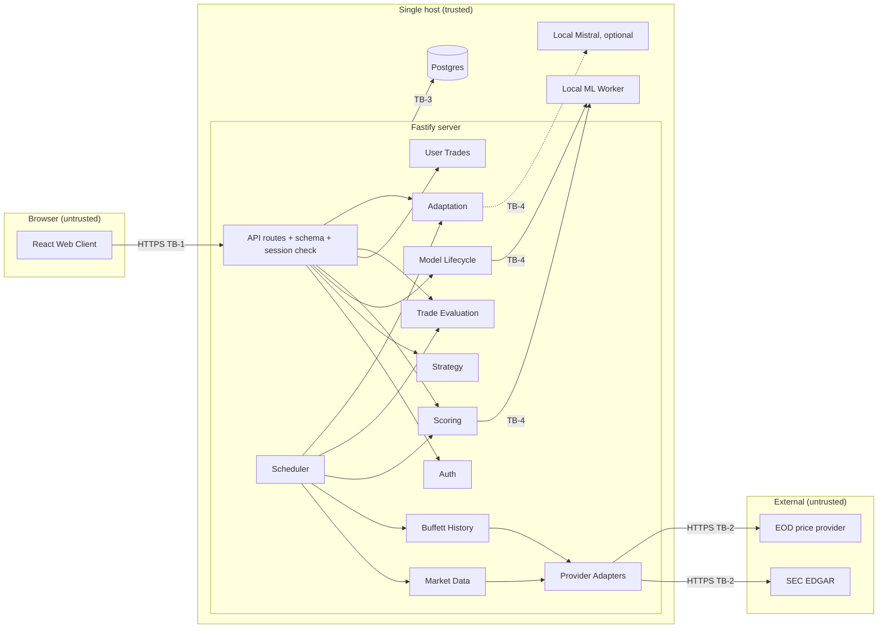
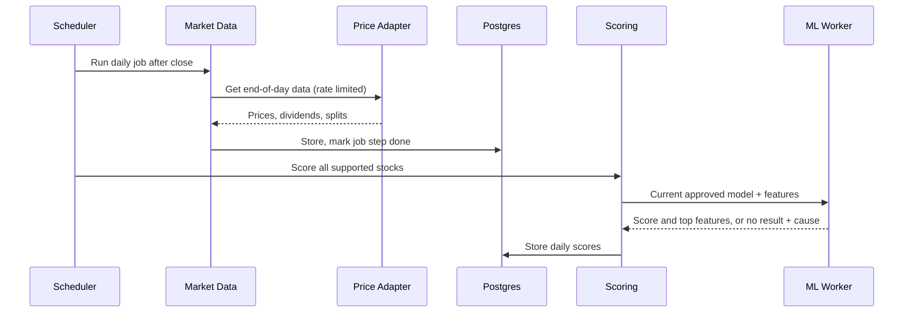
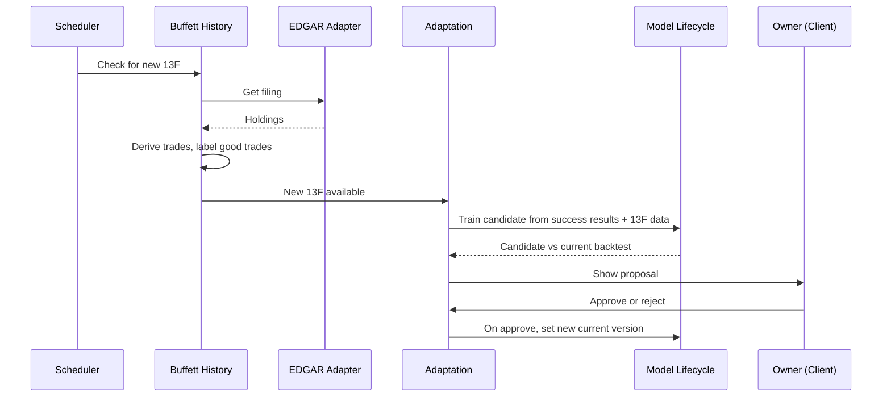
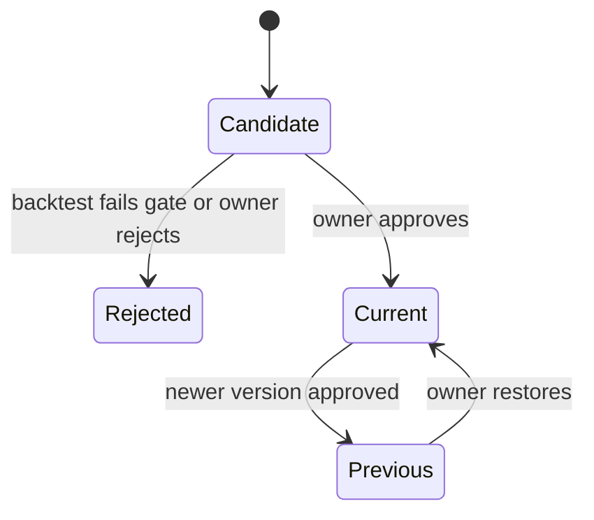

# ARCHITECTURE

Owns HOW the system is built. Behavior: `REQUIREMENTS.md`. Visual and frontend rules: `DESIGN.md`. Security controls: `SECURITY.md` (not yet written).

## Required Architecture Inputs

| Field | Value |
|---|---|
| Requirements source | `REQUIREMENTS.md` |
| Design source | `DESIGN.md` |
| Target surfaces | Desktop web browser, window 1024px or wider (NFR-1, NFR-7) |
| Runtime and deployment environment | Node.js runtime. Host, OS, CPU, RAM, and GPU: UNKNOWN |
| Server framework | Fastify on Node.js (developer input; see Conflict C-1) |
| Client framework(s) | React (developer input) |
| API style and integration model | PROPOSED: JSON over HTTPS REST, same-origin, served by Fastify. Outbound HTTPS pull from SEC EDGAR and one end-of-day price provider. No broker (FR-3.9) |
| Authentication and session model | One owner account, password login (FR-6.1, FR-6.2). PROPOSED: server-side session in Postgres, referenced by a secure HTTP-only cookie |
| Data model and scale expectations | One user. US common stocks on NYSE, NASDAQ, NYSE American with daily history from the first 13F trade to now (FR-1.1, FR-1.4). Exact stock count and data volume: UNKNOWN |
| Security expectations | HTTPS, encrypted user trade data at rest, salted password hashes, no user trade data sent outside (NFR-5, NFR-6). Detailed controls deferred to `SECURITY.md` |

### Conflicts and flags

- **C-1:** Inputs list "Server framework: Node.js" and "Server runtime: Fastify". Fastify is the framework and Node.js is the runtime. This document uses that reading.
- **C-2:** "Minstral" is read as Mistral AI's open-weight models. A language model is not a trade model. FR-3.3 requires a model trained from Buffett good trades and stock features, which is a tabular machine learning task. This document keeps the two separate (see Model choice).
- **C-3:** FR-1.5 requires analysis of all supported stocks with daily data. Free-tier price providers have tight request limits (FR-7.2). Whether one provider can supply the full universe within NFR-2 (2 hours) is UNKNOWN.

## Architecture and Decisions

- **Overall shape:** PROPOSED: one modular monolith (one Fastify process) plus Postgres, plus one local ML worker process. There are no microservices or message brokers. A single user does not need them.
- **Client:** React single-page app, built to static files and served by Fastify on the same origin. It holds no business rules. It shows server results only.
- **API:** PROPOSED: REST with JSON. Each request is checked against a schema at the edge (Fastify built-in schema validation).
- **Persistence:** Postgres is the only store for all data, including model artifact metadata and job state. PROPOSED: trained model files on local disk, with their checksum and version recorded in Postgres. User trade columns are encrypted at rest (NFR-5). The method is deferred to `SECURITY.md`.
- **Scheduling:** PROPOSED: a job scheduler inside the server process with job state in Postgres. Jobs are idempotent and continue after a restart (NFR-4). Jobs: daily end-of-day update (FR-1.3, FR-3.6), 13F check (FR-2.3), quarterly evaluation and proposal (FR-4.4, FR-5.2).
- **Authentication and session:** password hash with Argon2id (NFR-5). PROPOSED: server-side session, so logout and expiry work at once. Every API route except login requires a session.
- **Model choice:**
  - **Trade model (FR-3.3, FR-3.4):** PROPOSED: gradient-boosted decision trees on tabular stock features. They train on a CPU in minutes, work well with small labeled sets (the Buffett trade history), and give per-feature effects for the FR-3.7 reason. The runtime is TO BE DECIDED (AQ-1).
  - **Language model (optional):** PROPOSED: a local Mistral model only to write plain-language text for strategy and proposal summaries (FR-3.2, FR-5.3). It never makes scores. Size by available RAM, which is UNKNOWN:
    - 8–16 GB RAM, no GPU: Ministral 3B or Mistral 7B Instruct, 4-bit quantized.
    - 16–32 GB RAM or an 8 GB+ GPU: Ministral 8B Instruct, 4-bit. **Recommended default.**
    - 32 GB+ or a 16 GB+ GPU: Mistral Small (about 24B), 4-bit.
  - Run it through a local inference server on the same host (NFR-6). Exact server: TO BE DECIDED (AQ-2). Whether to use a language model at all: TO BE DECIDED (AQ-3).

## Components and Flows

| Component | Responsibility | Business rules enforced | Data owned | Requirements | Status |
|---|---|---|---|---|---|
| Web Client (React) | Show views from `DESIGN.md`. Enter and import trades. Approve proposals. Restore versions | None (presentation only) | None | NFR-1, NFR-3, NFR-7, NFR-8, FR-7.1 | SUPPORTED |
| API Gateway (Fastify routes) | HTTPS endpoints, input schema checks, session check | Login before use | None | FR-6.2, NFR-5 | SUPPORTED |
| Auth | Password check, session lifecycle | One account, one owner role | Account, Session | FR-6.1, FR-6.2, NFR-5 | SUPPORTED |
| Market Data | Get end-of-day prices, dividends, splits. Filter to US common stocks. Obey provider limits | Coverage and USD only. Rate limits | US stock, End-of-day market data | FR-1.1–1.5, FR-7.2, NFR-2 | PARTIALLY DEFINED (C-3) |
| Buffett History | Get 13F filings. Derive buy/add/reduce/sell. Label good trades against S&P 500 | 13F delta rule. Good-trade rule | 13F filing, Buffett historical trade, Good trade | FR-2.1–2.5, FR-7.2 | SUPPORTED |
| Strategy | Readable rules and feature weights. Versions | Strategy is separate from the model | Strategy, Strategy version | FR-3.1, FR-3.2, FR-5.5, FR-5.6 | SUPPORTED |
| Model Lifecycle | Train, backtest on held-out data, gate, version, restore | Backtest gate: beat S&P 500. Approved version only | Trade model, Model version, Backtest result | FR-3.3–3.5, FR-5.5–5.7 | PARTIALLY DEFINED (AQ-1, AQ-4) |
| Scoring | Daily scores 0–100, buy/hold/sell, top-feature reasons, "No result" with cause | Uses current approved model. Never trades | Daily score | FR-3.6–3.9, FR-5.7 | PARTIALLY DEFINED (AQ-5) |
| User Trades | Manual entry, CSV import, encryption at rest | Required fields. Private data stays local | User trade | FR-4.1, FR-4.2, NFR-5, NFR-6 | SUPPORTED |
| Trade Evaluation | Close-time and quarterly success checks | Success rule against S&P 500 | Trade success result | FR-4.3–4.5 | SUPPORTED |
| Adaptation | Build proposals from success results and new 13F data. Compare backtests. Apply only after approval | No change without approval | Proposal | FR-5.1–5.4, FR-5.7 | PARTIALLY DEFINED (AQ-6) |
| Scheduler | Run and resume daily and quarterly jobs | Idempotent, restart-safe | Job run | FR-1.3, FR-2.3, FR-4.4, FR-5.2, NFR-2, NFR-4 | SUPPORTED |
| ML Worker (local) | Train and run the trade model | None. Executes requests from Model Lifecycle and Scoring | Model files (on disk) | FR-3.3, FR-3.6, NFR-6 | TO BE DECIDED (AQ-1) |
| Text Model (local, optional) | Plain-language summaries | None | None | FR-3.2, FR-5.3 | TO BE DECIDED (AQ-3) |
| Provider Adapters | SEC EDGAR client, price provider client | Request limits, terms of use | None | FR-2.3, FR-1.3, FR-7.2 | PARTIALLY DEFINED (AQ-7) |

### Main data flows

1. **Daily update:** Scheduler → Market Data (provider adapter) → Postgres → Scoring → ML Worker → Daily scores. Must finish within 2 hours (NFR-2).
2. **13F ingest:** Scheduler → Buffett History (EDGAR adapter) → derive trades → label good trades → trigger Adaptation (FR-5.2).
3. **Train and gate:** Model Lifecycle reads Strategy, good trades, and market data → ML Worker trains on a training window and backtests on a held-out window → results shown only if the gate passes (FR-3.4, FR-3.5).
4. **User trade evaluation:** Client → User Trades (encrypted) → Trade Evaluation on close or each quarter → success result.
5. **Adaptation:** success results plus new 13F data → candidate strategy and model → backtest compare → owner approves → new current version (FR-5.4, FR-5.7). Restore sets an earlier version as current (FR-5.6).

### Trust boundaries

- **TB-1 Browser ↔ Server:** HTTPS only. Every request is untrusted until the session and schema checks pass.
- **TB-2 Server ↔ External providers:** outbound only. Responses are untrusted input and are validated before storage. No user trade data crosses this boundary (NFR-6).
- **TB-3 Server ↔ Postgres:** trusted host. User trade data encrypted at rest.
- **TB-4 Server ↔ Local ML Worker / Text Model:** same host, local connection only, never exposed to the network. Text model output is display text only and never drives scores or approvals.

## Dependency Rules

- **DR-1:** Web Client depends only on the API. It has no business rules and no direct access to data or providers.
- **DR-2:** API routes depend on domain modules. Domain modules never depend on API routes or HTTP types.
- **DR-3:** Each entity has one owning module (table above). Other modules read it through that module's interface, never by writing its tables.
- **DR-4:** Domain modules depend on adapter interfaces (providers, ML Worker, Text Model, storage). Vendor-specific code lives only in adapters.
- **DR-5:** Data flows one way: Market Data and Buffett History → Model Lifecycle → Scoring. User Trades → Trade Evaluation → Adaptation → Model Lifecycle and Strategy. No module calls back upstream.
- **DR-6:** Scheduler calls domain modules. Domain modules never call the Scheduler.
- **DR-7:** Only Model Lifecycle changes the current model and strategy versions, and only after owner approval or restore.
- **DR-8:** Adapters do not depend on each other. No circular dependencies between modules.

## Diagrams

### Components and trust boundaries

### Daily update

### 13F ingest and adaptation

### Version states

## Open Questions

- **AQ-1:** ML Worker runtime. PROPOSED: a separate Python process for tabular training (mature gradient-boosting libraries), called locally from Node. The alternative is Node-only ML, which keeps one language but has weaker libraries. TO BE DECIDED.
- **AQ-2:** Local inference server for the Mistral model. TO BE DECIDED.
- **AQ-3:** Whether a language model is needed at all, since no requirement asks for generated text. TO BE DECIDED.
- **AQ-4:** Backtest train and test windows and the walk-forward method. TO BE DECIDED.
- **AQ-5:** Score-to-recommendation thresholds (buy/hold/sell) and how many top features to show. TO BE DECIDED.
- **AQ-6:** How user success results and 13F data are weighted when building a proposal. TO BE DECIDED.
- **AQ-7:** Which price provider and plan, and whether it covers all supported stocks within request limits and NFR-2 (C-3). TO BE DECIDED.
- **AQ-8:** Source of stock features (P/E, ROE, debt, earnings stability) for FR-3.2: price provider fundamentals or SEC filings. UNKNOWN.
- **AQ-9:** Source of S&P 500 total-return data for FR-2.4, FR-3.5, and FR-4.3. UNKNOWN.
- **AQ-10:** CSV import column format for FR-4.2. TO BE DECIDED.
- **AQ-11:** Host hardware (RAM, GPU) that sets the model size. UNKNOWN.
- **AQ-12:** Session lifetime and idle timeout. TO BE DECIDED (detail in `SECURITY.md`).
