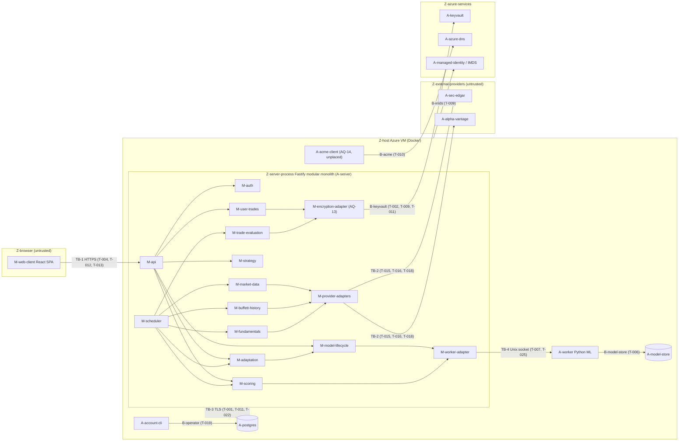
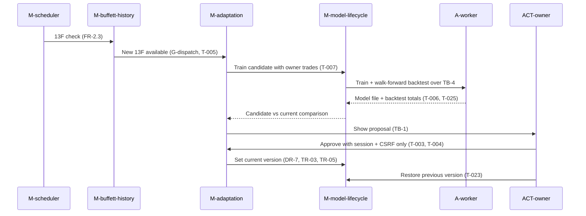
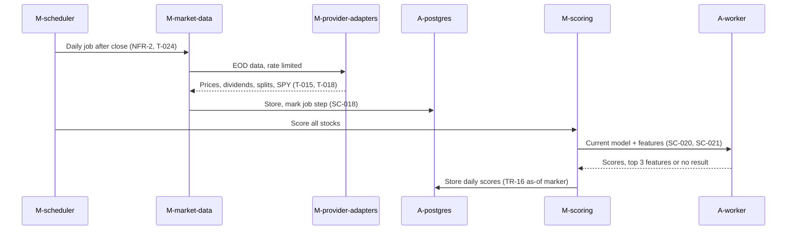

# Oracle Buffet - Threat Model Report (deep, 2026-10-30)

Owns the threat model: threats, risks, evidence, gaps, conflicts, proposed treatments, and coverage. Behavior: `REQUIREMENTS.md`. Architecture: `ARCHITECTURE.md`. Security controls: `SECURITY.md`. Design: `DESIGN.md`. The specification IDs that implement each treatment are in "Specification Traceability".

Model `oracle-buffet-tm-2026-10-30-deep` revision 05 (parent 04). Artifact: `05-report.json` (TM_REPORT). Primary architecture: **modular-monolith**; bounded secondaries: web, ai-ml, batch-workflows, container-platform, cicd-supply-chain. No optional methods were selected or run.

> This report describes a **specification-only** project at commit d6f4572. Every threat is a design hypothesis grounded in specification text, not a confirmed defect. Every treatment is **proposed**, every verification is **not_run**, every risk is **unrated**, and every decision is **proposed** with unknown owner and date. Record counts are not severity or assurance. Nothing here states the system is secure, compliant or production-ready. Treat this report as private review material.

## 1. Scope and evidence limits

Deep threat model of the Oracle Buffet specifications at commit d6f4572 (no implementation exists), primary architecture modular-monolith with bounded secondaries web, ai-ml, batch-workflows, container-platform and cicd-supply-chain. Purpose: harden REQUIREMENTS.md, ARCHITECTURE.md, SECURITY.md and DESIGN.md before implementation.

**In scope:** Web Client (React SPA) and TB-1; Fastify modular monolith: API, Auth, Market Data, Buffett History, Fundamentals, Strategy, Model Lifecycle, Scoring, User Trades, Trade Evaluation, Adaptation, Scheduler, Provider Adapters; Postgres and TB-3; Python ML worker, model files and TB-4; Azure VM and Docker host, shared volumes, managed identity; Azure Key Vault (AQ-13) and envelope encryption; ACME DNS-01 renewal via Azure DNS (AQ-14); SEC EDGAR and Alpha Vantage over TB-2; GitHub Actions CI with Trivy (light pass); Specification and agent workflow (AGENTS.md, CLAUDE.md)

**Out of scope:** Implementation code (none exists); Live cloud, GitHub and provider configuration; External secure-coding corpus content; DESIGN.md visual token values beyond security-relevant interactions; Investment correctness of the trading model except where integrity affects security objectives

**Objectives:**
- Identify specification gaps and design hypotheses that threaten confidentiality of user trade data and credentials, integrity of the model/strategy approval chain and training inputs, account and session security, and availability of the daily pipeline (NFR-2, NFR-4).
- Produce spec-hardening outcomes citing FR/NFR/DR/TB/SC IDs.

**Assumptions:**
- Specification text describes intended design, not implemented behavior.
- One human owner holds both the web account and host operator authority (E1, E7, G10).
- Selection outputs are carried analysis from this run, not independent evidence.

**Limitations (carried from all stages):**
- All system evidence is documentation claims except E52 (repository file listing) and E-lib (library listing).
- Working tree not checked because git clean/process filters are configured; caller claims it was clean (C1).
- Secure-coding packs not read (G31); technology-specific prescriptions remain unverified.
- Secondary quick/ prompt bodies not read (G-quick-secondaries).
- Registry checking of architecture identities used only the library file listing, not a supplied registry.
- JSON checks: parse with duplicate-key and non-finite rejection only; no schema validation exists.
- Stage 01 system records are all basis claimed from specification text; none is observed in an implementation.
- B-acme has no owning architecture (G-acme-owner); F-acme and F-ci-build have null targets (G2, G25).
- Stage 02 threats are all design_hypothesis grounded in specification claims; none is an evidenced weakness because no implementation exists.
- No risk rubric supplied; risks collection left empty and no ratings were assigned.
- Modular-monolith check 4 (dispatch/transaction scope) not assessed: mechanics are unspecified (G-dispatch).
- Stage 03 challenge used specification text only; confidence revisions reflect premise strength, not runtime effectiveness (G-03-runtime-challenge).
- Conflicts CF-001 to CF-003 remain unresolved; no observation evidence exists to resolve them.
- Stage 04 treatments are proposals for specification changes; none is implemented, accepted or approved, and every verification is not_run.
- Treatment outcomes name a proposed owning specification file; AGENTS.md requires the owner to make that change in the owning file, which this run did not do.
- Risks are unrated; no rubric was supplied (DEC-04-rubric proposes one).
- Stage 05 visualizations are proposed Mermaid text; none was rendered.

**Evidence:** 56 records. All system evidence is documentation claims from REQUIREMENTS.md, ARCHITECTURE.md, SECURITY.md, DESIGN.md, AGENTS.md and CLAUDE.md, plus one repository file listing (E52), one caller claim (C1) and library/selection provenance (E-lib, E-sel).

| Evidence | Locator | Statement |
|---|---|---|
| E1 | REQUIREMENTS.md:9-15 | Purpose: personal-use US stock ML tool modeled on Warren Buffett trades; one investor user, no other users; entities: US stock, end-of-day data, Buffett historical trade, good trade, strategy, trade m |
| E2 | REQUIREMENTS.md:21-25 | FR-1.1 to FR-1.5: US common stocks only (NYSE, NASDAQ, NYSE American), USD, EOD data once per trading day after close, daily price history with dividends/splits from first Buffett trade date, all supp |
| E3 | REQUIREMENTS.md:29-33 | FR-2.1 to FR-2.5: record Berkshire 13F trades from all available filings; derive buy/add/reduce/sell from deltas between sequential filings; fetch each new filing quarterly; label "good trade" if tota |
| E4 | REQUIREMENTS.md:37-49 | FR-3.1 to FR-3.11: strategy and trade model are separate objects; strategy is human-readable rules and feature weights; model trained from good trades and strategy; walk-forward backtest (first traini |
| E5 | REQUIREMENTS.md:53-58 | FR-4.1 to FR-4.5: user trade record (symbol, side, date, quantity, price); manual entry and CSV import; CSV header and columns fixed, invalid row rejects whole file with row number and cause; success  |
| E6 | REQUIREMENTS.md:62-68 | FR-5.1 to FR-5.7: proposals use user-trade success results and new 13F data; proposal each quarter after a new 13F and on user request; proposal includes candidate vs current backtest; no proposal app |
| E7 | REQUIREMENTS.md:72-81 | FR-6.1 to FR-6.5: one account; password login before use; no web sign-up, owner creates the account with a host command; password change requires current password; logout ends the session immediately. |
| E8 | REQUIREMENTS.md:85-93 | NFR-1 desktop web app; NFR-2 daily update and model results within 2 h of EOD data availability; NFR-3 page load <= 3 s; NFR-4 no HA, daily update resumes after restart without data loss; NFR-5 HTTPS  |
| E9 | REQUIREMENTS.md:95-97 | OQ-14 open: which view is "the results page" for FR-3.11. |
| E10 | ARCHITECTURE.md:12 | One Azure VM (`Standard_D4s_v5`, 256 GB Premium SSD data disk) running Docker; three containers on one internal Docker network: Fastify server (Node.js 26), Python ML worker (Python 3.13), Postgres. |
| E11 | ARCHITECTURE.md:13-18 | Fastify 5.12 / TypeScript 7 / Zod 4 / Prisma 7.10; React 19 client; same-origin JSON REST over HTTPS served by Fastify; outbound HTTPS pull from SEC EDGAR and Alpha Vantage; no broker; one owner accou |
| E12 | ARCHITECTURE.md:22-23 | N-1 framework/runtime correction; N-2 owner decision: no language model; feature reasons come from the trade model. |
| E13 | ARCHITECTURE.md:27-29 | Modular monolith (one Fastify process), Postgres, one local Python ML worker; no microservices/brokers; React SPA built to static files served by Fastify; Zod schemas applied via `setValidatorCompiler |
| E14 | ARCHITECTURE.md:30 | Postgres is the only database: all entities, job state, model version metadata. Trained model files on local disk with checksum and version in Postgres. User trade data uses envelope encryption in the |
| E15 | ARCHITECTURE.md:31 | In-process scheduler with job state in Postgres; jobs idempotent and resumable; jobs: daily EOD update and scoring, 13F check, quarterly evaluation and proposal. If Key Vault is unreachable, jobs need |
| E16 | ARCHITECTURE.md:32-35 | LightGBM gradient-boosted trees in the Python worker, saved/loaded in LightGBM text format; worker reached via Unix domain socket on a shared Docker volume with length-prefixed JSON; worker trains, ba |
| E17 | ARCHITECTURE.md:36-38 | Alpha Vantage Premium (75 req/min) for EOD prices, dividends, splits; one request per stock per day (~107 min for 8,000 stocks, inside NFR-2); history backfill over several nights. Fundamentals from S |
| E18 | ARCHITECTURE.md:44 | Fastify terminates HTTPS directly (no reverse proxy) with a public CA certificate; no port 80 listener; renewal by ACME DNS-01 against an Azure DNS zone, authenticated with the VM's managed identity;  |
| E19 | ARCHITECTURE.md:45 | Azure Key Vault holds application secrets and the key that wraps the trade-data key; server authenticates with the VM managed identity via `@azure/identity` `ManagedIdentityCredential`, `@azure/keyvau |
| E20 | ARCHITECTURE.md:46-48 | Plugins `@fastify/cookie`, `@fastify/session` (Postgres store), `@fastify/csrf-protection`, `@fastify/rate-limit`; `fast-xml-parser` for 13F XML; GitHub Actions CI with type checks, grep checks and Tr |
| E21 | ARCHITECTURE.md:52-68 | Component table (all SUPPORTED): Web Client, API, Auth (Account, Session), Market Data (US stock, EOD data, Benchmark series), Buffett History (13F filing, Buffett trade, Good trade), Fundamentals (St |
| E22 | ARCHITECTURE.md:70-76 | Flows: (1) daily update Scheduler → Market Data → Alpha Vantage → Postgres → Scoring → ML Worker → daily scores; (2) 13F ingest → derive trades → label → Fundamentals refresh → Adaptation; (3) train a |
| E23 | ARCHITECTURE.md:78-85 | Trust boundaries: TB-1 Browser ↔ Server (HTTPS terminated by Fastify; untrusted until session and schema checks pass); TB-2 Server ↔ SEC EDGAR / Alpha Vantage (outbound only, responses untrusted, no u |
| E24 | ARCHITECTURE.md:87-96 | DR-1 to DR-8: client depends only on API; routes depend on domain modules, not vice versa; single owning module per entity, others read via its interface and never write its tables; domain modules use |
| E25 | ARCHITECTURE.md:100-137 | Component diagram: browser untrusted; single host trusted (server, Postgres, worker); external untrusted (EDGAR, Alpha Vantage). Azure Key Vault, Azure DNS and the ACME CA are absent from the diagram. |
| E26 | ARCHITECTURE.md:139-202 | Sequence diagrams for daily update, 13F ingest and adaptation (owner approves or rejects; on approve Adaptation asks Model Lifecycle to set new current version), walk-forward backtest gate, and versio |
| E27 | ARCHITECTURE.md:204-208 | Open items AQ-13 (Key Vault component, wrapped-key storage, Server ↔ Key Vault trust boundary), AQ-14 (ACME client placement; conflicts with SC-016 outbound allowlist), AQ-15 (package manager and lock |
| E28 | SECURITY.md:5-10 | Material gaps: no evaluated secure-coding pack for the Azure Key Vault SDK / managed identity client, or for `fast-xml-parser`. |
| E29 | SECURITY.md:12-46 | Selected secure-coding prompts resolved from an external corpus (absolute local path present in the file; not copied here and not read in this run): ES2026, Node.js 26, React 19, TypeScript 7, Fastify |
| E30 | SECURITY.md:50-56 | SC-001 session required on every route except login, enforced by a scoped Fastify hook, not path-prefix middleware; HEAD routes covered. |
| E31 | SECURITY.md:57-76 | SC-002 `__Host-` cookie, Secure, HttpOnly, SameSite=Strict; 30 min idle and 8 h absolute, checked against Postgres record; no memory store; `saveUninitialized: false`. SC-003 session regenerate after  |
| E32 | SECURITY.md:77-97 | SC-004 Argon2id, >= 16-byte salt, m=19456 KiB, t=2, p=1. SC-005 login rate limits: 5/15 min per IP and 20 failed/hour per account, in-memory store, distinct prefixes, `skipOnError: false`, no forwardi |
| E33 | SECURITY.md:98-104 | SC-006 CSRF via `@fastify/csrf-protection` with session plugin, header-only token, on trade entry, CSV import, approve, reject, restore, proposal request, password change, logout. Login itself is not  |
| E34 | SECURITY.md:105-157 | SC-007 strict Zod schemas on params/querystring/headers/body, `z.strictObject`, lowercase header names, parsed output only, `attachValidation` off. SC-008 no coercion/defaults on trade fields and appr |
| E35 | SECURITY.md:158-178 | SC-012 Prisma args from validated scalars and allowlists, `strictUndefinedChecks`. SC-013 no unsafe raw SQL. SC-014 password hash excluded by `select` and client `omit`; every route has a response sch |
| E36 | SECURITY.md:179-192 | SC-015 AES-256-GCM per field for all user trade fields and trade success results, unique random nonce, 16-byte tag, no use before `final()`; yearly Key Vault key rotation with rewrap; data key stored  |
| E37 | SECURITY.md:193-201 | SC-016 no user trade data to EDGAR, Alpha Vantage, Azure or others; only Provider Adapters and the Key Vault adapter may make outbound calls; certificate-renewal calls open (AQ-14); Key Vault adapter  |
| E38 | SECURITY.md:202-224 | SC-017 fixed EDGAR/Alpha Vantage HTTPS origins, redirect error or checked, 60 s deadline, 50 MiB streaming cap, no TLS-verification override. SC-018 every provider response parsed with strict Zod befo |
| E39 | SECURITY.md:225-253 | SC-019 worker reachable only via Unix socket, mode 0660, group shared only by server and worker, no TCP listener, no published ports. SC-020 minimal job messages, no account/session/credential data, o |
| E40 | SECURITY.md:254-282 | SC-022 generic errors; logs redact cookies, authorization, passwords, Alpha Vantage key (including URLs), Key Vault secrets, data key, user trade fields. SC-023 CSP with no third-party origins plus HS |
| E41 | SECURITY.md:283-306 | SC-025 no `dangerouslySetInnerHTML`, no spreading untrusted objects into DOM props. SC-026 no secrets/session tokens in web storage or public build vars; clear cached user data on logout and expiry; s |
| E42 | SECURITY.md:307-340 | SC-028 startup reads secrets (DB password, Alpha Vantage key, session secret, CSRF key) from Key Vault with managed identity, Zod-validates and freezes config, exits non-zero before listening on failu |
| E43 | SECURITY.md:341-369 | SC-032 digest-pinned bases, multi-stage, `npm ci --omit=dev` (AQ-15), numeric non-root USER, exec-form entrypoint, read-only root FS. SC-033 no credentials in ARG/ENV/COPY/labels/layers; build secrets |
| E44 | SECURITY.md:370-414 | SC-035 TypeScript strict flags; untrusted data `unknown` until Zod parses; no assertion promotion. SC-036 no account-creation route; CLI refuses when account exists, password >= 15 chars; password cha |
| E45 | SECURITY.md:415-443 | No open security decisions in SECURITY.md itself; AQ-13 affects SC-015/016/028, AQ-14 affects SC-016/030, AQ-15 affects SC-027/032. OD-001 to OD-019 resolved 2026-10-30; OD-017 records that the owner  |
| E46 | DESIGN.md:163-169 | Views: Login, Daily Scores, Stock Detail, Buffett Trades, Strategy and Model Versions, Proposals, My Trades (entry + CSV import), Trade Results, Change Password; Log out in nav bar on every authentica |
| E47 | DESIGN.md:179-192 | Components: score row, no-result row (shows cause text), recommendation badge, version card with "Go back to this version", proposal comparison with Approve/Reject, hidden-model state card, trade form |
| E48 | DESIGN.md:136, DESIGN.md:194-204 | positive/negative never the sole signal; DQ-6 open on word-or-icon versus text pairing. Don'ts: no "Trade now"/"Execute" wording, no urgency animation, no NFR-9-prohibited imagery. |
| E49 | AGENTS.md:1-31, CLAUDE.md:1 | Specification-first agent instructions: implement only specified behavior; record missing facts as TO BE DECIDED; do not implement open items; stop on spec conflicts; no unlisted dependency, component |
| E50 | AGENTS.md:33-43 | Workflow items all TO BE DECIDED: repository layout, package managers and lockfile policy (AQ-15), build/run/lint/test commands, test frameworks and coverage, local dev environment, database migration |
| E51 | REQUIREMENT_TEMPLATE.md:1-15 (template header read; remainder of 122 l | Per-requirement template for leaf issues; not system behavior. |
| E52 | `git ls-files` at d6f4572 (protected form) | Tracked files: AGENTS.md, ARCHITECTURE.md, CLAUDE.md, DESIGN.md, README.md, REQUIREMENTS.md, REQUIREMENT_TEMPLATE.md, SECURITY.md, logo.svg. No source code, Dockerfiles, CI workflow files, lockfiles,  |
| E53 | ARCHITECTURE.md:44-45; SECURITY.md:307-313; SECURITY.md:193-201 | The checklist applies: one VM managed identity is the documented service identity for (a) reading application secrets (DB password, Alpha Vantage key, session secret, CSRF key) from Key Vault, (b) wra |
| C1 | caller session instructions, 2026-10-30 | Working tree was clean at start; project is specification-only; purpose is to harden specifications before implementation. |
| E-lib | LIBRARY_ROOT runbook.md, deep/modular-monolith/00-scope-and-evidence.m | Grim Prompter library prompts and references used for this run were present and read in full (frontmatter skipped); quick/ prompts for secondaries exist by file listing. |
| E-sel | threat-model/2026-10-30-deep/selection.json; selection.md | Architecture selection report chose primary modular-monolith with bounded secondaries web (TB-1), ai-ml (TB-4 and model lifecycle), batch-workflows (scheduler and provider ingest), container-platform  |

**Inputs read:** IN-sur (read); IN-selection (read); IN-library (read); IN-00-context (read); IN-01-system-model (read); IN-02-analysis (read); IN-03-reviewed-model (read); IN-04-treatment-plan (read). **Not read:** IN-quick-secondaries: Composition guide does not require them for stage 00; recorded as G-quick-secondaries.; IN-corpus: Outside authorized roots (G31).; IN-live: No network use authorized; specification-only project.

## 2. Unified system model

### Diagram: components and trust boundaries

Text equivalent: Browser SPA reaches the Fastify process over TB-1. Inside one process, API routes call domain modules; User Trades and Trade Evaluation use the encryption component (AQ-13) which reaches Key Vault; Scheduler drives Market Data, Buffett History, Fundamentals, Scoring, Trade Evaluation and Adaptation; Provider Adapters reach SEC EDGAR and Alpha Vantage over TB-2; Model Lifecycle and Scoring reach the Python worker over the TB-4 Unix socket; the worker writes the model store; the process reaches Postgres over TB-3. The unplaced ACME client reaches Azure DNS; all host containers can potentially reach IMDS for the managed identity; the account CLI writes Postgres from the operator boundary. Not drawn: CI (B-ci), specification repository and coding agents (B-agent-spec), Azure subscription control plane (G-03-azure-control-plane).

### Assets and modules

| ID | Kind | Description |
|---|---|---|
| M-web-client | logical-module | React SPA built to static files; presentation only; no business rules (DR-1). |
| M-api | logical-module | Fastify routes: HTTPS endpoints, Zod schema checks, session check; enforces login before use. |
| M-auth | logical-module | Auth module: password check, session lifecycle; owns Account and Session. |
| M-market-data | logical-module | Market Data module: EOD prices, dividends, splits, SPY benchmark, daily stock list; owns US stock, EOD data, Benchmark series. |
| M-buffett-history | logical-module | Buffett History module: 13F filings, derived trades, good-trade labels. |
| M-fundamentals | logical-module | Fundamentals module: EDGAR XBRL financial data, stock features. |
| M-strategy | logical-module | Strategy module: readable rules, feature weights, strategy versions. |
| M-model-lifecycle | logical-module | Model Lifecycle module: train, walk-forward backtest, FR-3.5 gate, versions, restore; only module allowed to change current model/strategy (DR-7). |
| M-scoring | logical-module | Scoring module: daily scores, recommendation, top-3 features, No result; current approved model only. |
| M-user-trades | logical-module | User Trades module: manual entry, CSV import, field encryption at rest. |
| M-trade-evaluation | logical-module | Trade Evaluation module: close-time and quarterly success checks; owns trade success results. |
| M-adaptation | logical-module | Adaptation module: builds proposals, compares backtests, applies only after approval. |
| M-scheduler | logical-module | In-process scheduler: daily, 13F and quarterly jobs; job state in Postgres; idempotent and resumable. |
| M-provider-adapters | logical-module | Provider Adapters: SEC EDGAR and Alpha Vantage clients; only modules permitted outbound calls with the Key Vault adapter. |
| M-encryption-adapter | logical-module | Encryption adapter / Key Vault adapter named by SC-015 and SC-016; component, owner and location undecided (AQ-13). |
| M-worker-adapter | logical-module | ML Worker adapter in the server used by Model Lifecycle and Scoring to call the worker. |
| A-server | container | Fastify server container (Node.js 26) hosting the modular monolith and serving HTTPS directly with a public CA certificate. |
| A-postgres | container | Postgres container: the only database; all entities, sessions, job state, model metadata and checksums, encrypted trade data. |
| A-worker | container | Python 3.13 ML worker container: LightGBM training, backtest, scoring; no business rules; no Postgres access. |
| A-socket-volume | shared-volume | Shared Docker volume holding the Unix domain socket between server and worker. |
| A-model-store | file-store | Local disk directory of trained LightGBM text-format model files; checksum and version recorded in Postgres. Which containers mount it and with what permissions is unspecified. |
| A-static-root | file-store | Dedicated static root with the React build output served by Fastify. |
| A-account-cli | cli | Server CLI run inside the server container to create the single owner account. |
| A-vm-host | host | Azure VM (Standard_D4s_v5) with Docker daemon and 256 GB data disk. |
| A-keyvault | external-service | Azure Key Vault: application secrets and the key that wraps the trade-data key. |
| A-azure-dns | external-service | Azure DNS zone used for ACME DNS-01 TXT records. |
| A-managed-identity | identity | VM managed identity used for Key Vault and Azure DNS; type and grants unspecified. |
| A-acme-client | process | ACME DNS-01 client for certificate renewal; component and placement undecided (AQ-14). |
| A-acme-ca | external-service | Public certificate authority issuing the server TLS certificate. |
| A-sec-edgar | external-service | SEC EDGAR: 13F filings and XBRL company financial data. |
| A-alpha-vantage | external-service | Alpha Vantage Premium: EOD prices, dividends, splits, LISTING_STATUS, SPY adjusted series. |
| A-ci | ci-service | GitHub Actions running type checks, grep checks and Trivy image scans; registry and deployment path unspecified. |
| A-spec-repo | repository | Specification repository consumed by coding agents as instructions (AGENTS.md imports the spec files). |

### Actors

| ID | Kind | Description |
|---|---|---|
| ACT-owner | human | Single investor owner: the only web user (one role). |
| ACT-host-operator | human | Person with host shell and Docker access who runs the account CLI; same individual as the owner per the spec, but a distinct authority. |
| ACT-coding-agent | automation | Coding agents that implement the system following AGENTS.md and CLAUDE.md. |
| ACT-provider-operators | external | Operators of SEC EDGAR and Alpha Vantage, who control response content. |

### Data

| ID | Kind | Description |
|---|---|---|
| D-account | data | Owner account with Argon2id password hash (SC-004). |
| D-session | data | Server-side session records in Postgres, carried by a __Host- cookie. |
| D-user-trade | data | User trade records (symbol, side, date, quantity, price); private; field-encrypted. |
| D-trade-result | data | Trade success results; encrypted per SC-015. |
| D-csv-upload | data | CSV trade import payload (text/csv, max 1 MiB, 10,000 rows). |
| D-data-key | data | Trade-data encryption key, stored only wrapped by the Key Vault key; storage location undecided. |
| D-app-secrets | data | DB password, Alpha Vantage API key, session secret, CSRF key held in Key Vault and loaded at startup. |
| D-tls-material | data | Public TLS certificate and private key for Fastify; private CA and Postgres server key for TB-3. |
| D-mi-token | data | Managed-identity access tokens for Key Vault and Azure DNS. |
| D-stock-list | data | Daily stock universe from LISTING_STATUS. |
| D-market-data | data | EOD prices, dividends, splits for supported stocks. |
| D-benchmark | data | SPY adjusted total-return series used as S&P 500 baseline. |
| D-13f | data | Berkshire 13F filings (XML information tables). |
| D-buffett-trades | data | Derived Buffett trades and good-trade labels. |
| D-features | data | Stock features from EDGAR XBRL. |
| D-strategy-versions | data | Strategy rules and feature weights, all versions. |
| D-model-metadata | data | Model version records, status and SHA-256 checksums. |
| D-model-files | data | Trained LightGBM text model files, including candidates trained with owner trades. |
| D-backtest | data | Backtest results used for the FR-3.5 gate and proposal comparison. |
| D-daily-scores | data | Daily score, recommendation, top-3 features or No result with cause. |
| D-proposal | data | Proposals with candidate vs current backtest; approve/reject state. |
| D-job-state | data | Scheduler job runs and step states. |
| D-worker-messages | data | Length-prefixed JSON job messages and replies over TB-4; owner trades only in proposal-training jobs. |
| D-logs | data | Server and worker logs with SC-022 redaction; destination unspecified. |
| D-container-images | data | Server and worker images built from digest-pinned bases. |

### Zones

| ID | Kind | Description |
|---|---|---|
| Z-browser | zone | Owner's desktop browser; untrusted per component diagram. |
| Z-host | zone | Single Azure VM running Docker; marked trusted in the component diagram. Contains server, Postgres and worker containers on one internal Docker network. |
| Z-server-process | zone | One Fastify Node.js process hosting all domain modules (modular monolith). Module boundaries are logical only; no runtime isolation is specified. |
| Z-external-providers | zone | SEC EDGAR and Alpha Vantage; untrusted. |
| Z-azure-services | zone | Azure Key Vault, Azure DNS and the managed-identity token endpoint; no trust zone is defined in the spec. |
| Z-ci | zone | GitHub Actions CI; only named in the spec. |
| Z-operator | zone | Host operator access to the VM (shell, Docker); access path unspecified. |

### Entry points

| ID | Kind | Description |
|---|---|---|
| EP-login | entry_point | POST login route; unauthenticated; per-IP and per-account rate limits; not CSRF-protected. |
| EP-logout | entry_point | Logout route; CSRF-protected. |
| EP-password-change | entry_point | Password change route; current password required; CSRF-protected. |
| EP-trade-entry | entry_point | Manual trade entry route; CSRF-protected. |
| EP-csv-import | entry_point | CSV import route (text/csv); CSRF-protected. |
| EP-proposal-request | entry_point | On-demand proposal request route (triggers training). |
| EP-approve | entry_point | Proposal approve route. |
| EP-reject | entry_point | Proposal reject route. |
| EP-restore | entry_point | Restore previous strategy/model version route. |
| EP-read-routes | entry_point | Authenticated read routes for views (scores, stock detail, Buffett trades, versions, proposals, my trades, results). |
| EP-static | entry_point | Static asset serving of the React build. |
| EP-account-cli | entry_point | Host CLI command creating the owner account. |
| EP-worker-socket | entry_point | Worker Unix socket listener. |
| EP-scheduler-jobs | entry_point | Scheduler-triggered jobs (daily, 13F, quarterly). |
| EP-provider-responses | entry_point | Inbound provider response content processed by adapters (EDGAR XML/JSON, Alpha Vantage JSON/CSV). |
| EP-host-admin | entry_point | Host administration access (shell, docker exec); path unspecified. |

### States

| ID | Kind | Description |
|---|---|---|
| ST-candidate | version-state | Candidate strategy/model version awaiting gate and owner decision. |
| ST-current | version-state | Current approved version used for all results (FR-5.7). |
| ST-previous | version-state | Previous version, restorable. |
| ST-rejected | version-state | Rejected candidate (fails gate or owner rejects). |
| ST-hidden-results | display-state | Results hidden because backtest does not beat S&P 500 (FR-3.5). |
| ST-session | session-state | Session active, idle-expired (30 min) or absolute-expired (8 h), destroyed at logout. |
| ST-job-step | job-state | Job step done or failed; failed provider validation recorded as failed step. |

### Trust boundaries

| ID | Owner architecture | Sides | Description | Gaps |
|---|---|---|---|---|
| TB-1 | web | Z-browser, A-server | Browser to server over HTTPS terminated by Fastify; untrusted until session and schema checks pass. | G16, G27 |
| TB-2 | batch-workflows | A-server, Z-external-providers | Server to SEC EDGAR and Alpha Vantage; outbound only; responses untrusted; no user trade data. | G14, G24 |
| TB-3 | modular-monolith | A-server, A-postgres | Server to Postgres over TLS with private CA on the internal Docker network. | G6, G7 |
| TB-4 | ai-ml | A-server, A-worker | Server to ML worker over Unix socket on a shared volume; not a network hop. | G29, G30 |
| B-module-ownership | modular-monolith | Z-server-process, A-postgres | Logical module boundaries inside one process: single owning module per entity, others read through its interface and never write its tables (DR-3); only Model Lifecycle changes current versions (DR-7). Enforcement mechanism and DB principal separation unspecified. | G-module-enforcement, G6 |
| B-keyvault | modular-monolith | A-server, A-keyvault | Server to Azure Key Vault for secrets and wrap/unwrap; not defined in the spec (AQ-13). | G1, G18, G19, G20 |
| B-imds | container-platform | Z-host, A-managed-identity | Containers to the managed-identity token endpoint; which containers can obtain tokens is unspecified. | G11, G19 |
| B-acme | unknown (open gap) | A-azure-dns, A-acme-ca | ACME client to Azure DNS and the public CA; client placement undecided (AQ-14). | G2, G-acme-owner |
| B-model-store | ai-ml | A-worker, A-model-store | Writers and readers of model files on local disk (worker, server); permissions unspecified. | G12, G13 |
| B-operator | container-platform | Z-operator, Z-host | Host operator to VM and containers (shell, docker exec, CLI). | G10 |
| B-ci | cicd-supply-chain | Z-ci, Z-host | CI to images, registry and deployment to the VM; unspecified beyond Trivy. | G25, G3 |
| B-agent-spec | cicd-supply-chain | A-spec-repo, Z-ci | Specification files to coding agents that implement the system; human review undecided. | G32 |

### Flows

| ID | Source | Target | Boundaries | Description |
|---|---|---|---|---|
| F-login | ACT-owner | EP-login | TB-1 | Owner submits password; Auth verifies and regenerates session. |
| F-ui-api | M-web-client | M-api | TB-1 | SPA calls JSON REST API with session cookie and CSRF header. |
| F-trade-entry | EP-trade-entry | M-user-trades | TB-1 | Owner enters a trade; User Trades validates and encrypts before Prisma write. |
| F-csv-import | EP-csv-import | M-user-trades | TB-1 | Owner uploads CSV; whole-file validation in one transaction. |
| F-encrypt-store | M-encryption-adapter | A-postgres | TB-3 | User Trades and Trade Evaluation write encrypted fields to Postgres via the encryption adapter. |
| F-wrap-unwrap | M-encryption-adapter | A-keyvault | B-keyvault, B-imds | Encryption adapter sends the data key to Key Vault for wrap/unwrap using the managed identity. |
| F-startup-secrets | A-keyvault | A-server | B-keyvault, B-imds | Server reads application secrets from Key Vault at startup. |
| F-av-fetch | A-alpha-vantage | M-provider-adapters | TB-2 | Market Data via Alpha Vantage adapter fetches stock list, EOD data and SPY; strict Zod validation before write. |
| F-edgar-fetch | A-sec-edgar | M-provider-adapters | TB-2 | Buffett History and Fundamentals via EDGAR adapter fetch 13F XML and XBRL data. |
| F-13f-derive | M-buffett-history | A-postgres | B-module-ownership | Buffett History derives trades and labels good trades using market and benchmark data. |
| F-13f-to-adaptation | M-buffett-history | M-adaptation | B-module-ownership | Buffett History signals Adaptation that a new 13F is available (in-process; mechanics unspecified). |
| F-train | M-worker-adapter | EP-worker-socket | TB-4 | Model Lifecycle sends training/backtest jobs with features, labels and strategy to the worker. |
| F-proposal-train | M-adaptation | EP-worker-socket | TB-4 | Adaptation candidate training sends owner trades and success results in plaintext to the worker. |
| F-model-write | A-worker | A-model-store | B-model-store | Worker writes model files to the model store; checksum recorded by Model Lifecycle. |
| F-score | M-scoring | EP-worker-socket | TB-4 | Scoring sends current model reference, checksum and features to the worker; stores daily scores. |
| F-approve | ACT-owner | EP-approve | TB-1, B-module-ownership | Owner approves or rejects a proposal; Adaptation asks Model Lifecycle to set new current version. |
| F-restore | ACT-owner | EP-restore | TB-1 | Owner restores a previous version; Model Lifecycle makes it current. |
| F-evaluate | M-trade-evaluation | A-postgres | TB-3, B-module-ownership | Trade Evaluation reads decrypted trades, prices and benchmark; writes encrypted success results. |
| F-scheduler | M-scheduler | EP-scheduler-jobs | B-module-ownership | Scheduler invokes domain modules for daily, 13F and quarterly jobs; records job state. |
| F-session-store | M-auth | A-postgres | TB-3 | Auth reads and writes session records in Postgres. |
| F-acme | A-acme-client | unknown (open gap) | B-acme, B-imds | ACME client writes DNS-01 TXT records with the managed identity and obtains certificates from the CA. |
| F-cli-create | ACT-host-operator | EP-account-cli | B-operator | Host operator runs the account CLI in the server container. |
| F-ci-build | A-ci | unknown (open gap) | B-ci | CI builds and scans images; publication and deployment to the VM unspecified. |
| F-static | EP-static | M-web-client | TB-1 | Browser loads SPA assets from the static root with CSP and HSTS headers. |
| F-agent-impl | A-spec-repo | ACT-coding-agent | B-agent-spec | Coding agents read the spec files and produce implementation changes. |

### Dependencies

| ID | Description | Gaps |
|---|---|---|
| DEP-alpha-vantage | Daily pipeline depends on Alpha Vantage Premium availability and 75 req/min plan for NFR-2. | G24 |
| DEP-edgar | 13F ingest and fundamentals depend on SEC EDGAR. | G24 |
| DEP-keyvault | Startup and trade-data jobs depend on Key Vault reachability. | G33, G20 |
| DEP-managed-identity | Key Vault and DNS access depend on one VM managed identity. | G18, G19 |
| DEP-azure-dns-ca | Certificate renewal depends on Azure DNS and the public CA. | G2 |
| DEP-npm-packages | Server and client depend on Fastify plugins, Zod, Prisma, @azure SDKs, fast-xml-parser, React; newest versions, lockfile policy undecided. | G3, G31 |
| DEP-python-packages | Worker depends on LightGBM and Python 3.13 packages; pinning policy undecided. | G3 |
| DEP-base-images | Images depend on digest-pinned Node.js 26 and Python 3.13 base images. | G3 |
| DEP-github-actions | CI depends on GitHub Actions and Trivy. | G25 |
| DEP-postgres | All modules depend on the one Postgres instance and its shared credential. | G6 |
| DEP-worker | Scoring, training and proposals depend on the single worker process. | G29 |

### Diagram: 13F ingest, proposal, approval and restore

Text equivalent: Scheduler checks for a 13F filing; Buffett History signals Adaptation (dispatch unspecified, T-005); Adaptation asks Model Lifecycle to train a candidate that includes owner trades (T-007); the worker trains and returns a model file and backtest totals (T-006, T-025); the owner sees the proposal and approves with session plus CSRF only (T-003, T-004); Model Lifecycle sets the current version (TR-03, TR-05). Restore follows the same final step (T-023).

### Diagram: daily update

Text equivalent: Scheduler starts the daily job; Market Data pulls end-of-day data through Provider Adapters (T-015 data integrity, T-018 key leakage), stores it and records the job step; Scoring sends the current model and features to the worker and stores daily scores. Resumption after restart may mix trading days (T-024).

## 3. Modular monolith handoff

**Process and logical boundaries.** One Fastify process hosts fifteen logical modules (E13, E21). Module boundaries are logical only: DR-1 to DR-8 (E24) state ownership and one-way flow, but no mechanism enforces them (G-module-enforcement). The Python worker is a separate container reached only over a Unix socket (TB-4); Postgres is a separate container over TLS (TB-3).

**Data ownership versus storage authority.** Each entity has one owning module (DR-3), but all modules share one Prisma client and, as far as the specification states, one database credential (G6). Ownership is therefore a code convention, not a storage permission. Model files are owned by Model Lifecycle but written by the worker (G12).

**Approved operations.** Only Model Lifecycle may change current model and strategy versions, and only after owner approval or restore (DR-7, FR-5.4, FR-5.6). Approve, reject, restore and proposal request are protected by session (SC-001) and CSRF (SC-006).

| Family | Supported status | Threats | Proposed treatments |
|---|---|---|---|
| Direct data bypass | Design hypothesis; DR-3/DR-7 stated but unenforced; SC-012/SC-013 constrain query construction only | T-001, T-002, T-011, T-022 | TR-01, TR-02, TR-12, TR-22 |
| Lost internal authorization context | Design hypothesis; approval not bound to the artifact shown; restore preconditions unstated; no audit trail | T-003, T-004, T-023 | TR-03, TR-04, TR-23 |
| Privileged event effects | Not assessable in depth: dispatch, transaction, retry and ordering unspecified (G-dispatch) | T-005, T-024 | TR-05, TR-16 |

**Shared resource limits.** One 4-vCPU VM runs web, scheduler, training and scoring; no concurrency or deadline rule covers training or worker calls (T-016, T-017; TR-17). **Deployment privileges.** Host operator, Azure control plane and CI hold authority equal to or above the application (T-019, T-020, T-021; G10, G25, G-03-azure-control-plane). No physical isolation is claimed beyond the three containers the specification lists, and module coupling alone is not reported as a flaw.

## 4. Threats

All 25 threats are open design hypotheses. Confidence describes the strength of the premise after the stage 03 challenge, not likelihood or impact.

| ID | Architectures | Confidence | Objective | Scenario | Affected | Gaps | Treatments |
|---|---|---|---|---|---|---|---|
| T-001 | modular-monolith | medium | Integrity of the current model and strategy version (approval chain). | A non-owning module (through a defect, a malicious or compromised dependency, or agent-written code) writes Model Lifecycle or Strategy version tables directly through the shared Prisma client and shared DB credential, making a candidate current without the approval path that DR-7 and FR-5.4 require. | B-module-ownership, M-model-lifecycle, M-strategy, D-model-metadata, D-strategy-versions, DEP-postgres, A-postgres | G-03-runtime-challenge, G-migration-authority, G-module-enforcement, G6 | TR-01, TR-23 |
| T-002 | modular-monolith | low | Confidentiality of user trade data (NFR-5, NFR-6). | Because the encryption adapter is an unplaced component (AQ-13) callable in-process, any module can request decryption of user trades; a module with outbound access (Provider Adapters) or logging can then disclose plaintext trade fields, defeating NFR-6 and SC-016 intent. | M-encryption-adapter, M-provider-adapters, M-user-trades, M-trade-evaluation, D-user-trade, D-trade-result, D-logs | G-03-runtime-challenge, G-module-enforcement, G1, G9 | TR-02 |
| T-003 | modular-monolith, ai-ml | medium | Integrity of FR-5.4 owner approval and FR-5.7 current-model selection. | Approval is not bound to the exact candidate shown: between display and approve, the candidate's model file, checksum or backtest record changes (retrain, duplicate proposal job, or file replacement), so the owner's approval makes a different artifact current. | EP-approve, F-approve, D-proposal, D-model-metadata, D-model-files, ST-candidate, ST-current, M-adaptation | G-03-audit-repudiation, G-03-runtime-challenge, G-dispatch, G12, G15 | TR-03, TR-23 |
| T-004 | web, modular-monolith | low | Integrity of model/strategy changes and confidentiality of trades via read routes. | An attacker who gains a valid owner session (stolen cookie on the owner desktop, XSS through provider-derived text if SC-025 fails, or an unattended browser) approves a proposal or restores a version with only session plus CSRF header, with no re-authentication or confirmation. | EP-approve, EP-restore, EP-read-routes, TB-1, D-session, M-web-client | G-03-audit-repudiation, G-03-runtime-challenge, G15, G16 | TR-04, TR-23 |
| T-005 | modular-monolith, batch-workflows | medium | Integrity of DR-7/FR-5.4 under scheduler-originated events. | The 'New 13F available' hand-off and scheduler jobs run with system authority; if the Adaptation handler or a retried/duplicated quarterly job reaches the 'set current version' operation without independently checking an owner approval record, a scheduler-originated event causes a privileged version change. Duplicate or reordered runs may also create competing proposals. | F-13f-to-adaptation, F-scheduler, M-scheduler, M-adaptation, M-model-lifecycle, D-job-state, D-proposal | G-03-runtime-challenge, G-dispatch, G15 | TR-05 |
| T-006 | ai-ml, modular-monolith | medium | Integrity of trade model files and daily scores. | A principal that can write both the model store and the checksum/metadata (the worker reporting its own checksum, or the server) replaces a model file; SC-021 then verifies the forged checksum and Scoring serves manipulated scores and reasons. | B-model-store, A-model-store, D-model-files, D-model-metadata, A-worker, F-model-write, F-score | G-03-runtime-challenge, G12, G30 | TR-06 |
| T-007 | ai-ml, modular-monolith | high | Confidentiality of user trade data at rest (NFR-5). | Owner trades and success results travel in plaintext over TB-4 to proposal-training jobs and are embedded as training examples in candidate model files, worker temp files, logs, swap and backups that lie outside SC-015 field encryption; anyone reading the model store or a disk/backup snapshot recovers trade-derived data. | F-proposal-train, D-worker-messages, D-model-files, A-model-store, A-worker, A-vm-host | G-03-runtime-challenge, G13, G8 | TR-08 |
| T-008 | ai-ml, container-platform | medium | Confidentiality of user trade data (NFR-6). | A compromised Python dependency in the worker exfiltrates owner trades received in proposal-training messages, because SC-016's outbound allowlist governs server modules only and worker egress is unspecified. | A-worker, DEP-python-packages, D-worker-messages, F-proposal-train | G-03-runtime-challenge, G11, G13, G3 | TR-09 |
| T-009 | modular-monolith, container-platform | medium | Confidentiality of secrets and trade data; authenticity of the TLS endpoint. | One VM managed identity serves Key Vault secret reads, key wrap/unwrap and Azure DNS writes. Any process that can reach IMDS on the VM (server, worker, Postgres container, or an ACME client) can obtain tokens with the union of these grants: read all app secrets, unwrap the trade-data key, and write DNS records to obtain a valid certificate for the domain (TB-1 interception). | A-managed-identity, B-imds, A-keyvault, A-azure-dns, D-app-secrets, D-data-key, D-mi-token, D-tls-material, A-worker, A-postgres | G-03-azure-control-plane, G-03-runtime-challenge, G11, G18, G19, G20 | TR-10 |
| T-010 | container-platform, modular-monolith | high | Availability of TB-1 and integrity of the outbound allowlist. | AQ-14 leaves the ACME client unplaced. If it runs in the server, SC-016/SC-017 must widen outbound destinations (CA, Azure DNS), weakening the egress allowlist that protects trade data; if renewal is not built, certificate expiry halts the HTTPS-only service (SC-030) and pressures an unsafe fallback (port 80 HTTP-01). | A-acme-client, B-acme, F-acme, A-server, DEP-azure-dns-ca, M-provider-adapters | G-03-runtime-challenge, G-acme-owner, G2 | TR-11 |
| T-011 | modular-monolith | medium | Integrity of user trade records and success results feeding proposals. | SC-015 encrypts each field with AES-256-GCM but binds no associated data, so a party able to write the trade or result tables can swap or replay valid ciphertexts between rows and fields (e.g., side, quantity, success flag); decryption succeeds and Trade Evaluation and Adaptation consume altered data. | D-user-trade, D-trade-result, A-postgres, M-encryption-adapter, M-trade-evaluation | G-03-runtime-challenge, G23, G6 | TR-12 |
| T-012 | web | low | Integrity of authentication and availability of login. | Login is not CSRF-protected (SC-006 excludes it). A hostile site can make the owner's browser submit login attempts, consuming the per-account budget or attempting guesses from the owner's IP. | EP-login, F-login, TB-1 | G-03-runtime-challenge, G27 | TR-13 |
| T-013 | web | high | Availability of owner login; resistance to online guessing. | SC-005's per-account limit (20 failed attempts/hour, keyed by the one account, from any IP) lets a remote attacker rotating IPs keep the owner locked out indefinitely; in-memory counters also reset on restart, granting fresh guess budgets. | EP-login, M-auth, D-account | G-02-lockout-policy, G-03-audit-repudiation, G-03-runtime-challenge, G10, G28 | TR-13, TR-23 |
| T-014 | modular-monolith, batch-workflows | medium | Availability of the daily pipeline and secret confidentiality. | SC-028 requires exit before listening if Key Vault is unreachable, while ARCHITECTURE says only trade-data jobs fail during outage. A restart (NFR-4) during a Key Vault or IMDS outage leaves the whole service down and the daily pipeline missed (NFR-2); implementers may instead cache secrets on disk, violating SC-028/SC-033. | DEP-keyvault, A-keyvault, A-server, M-scheduler, D-app-secrets | G-03-runtime-challenge, G21, G33 | TR-14 |
| T-015 | ai-ml, batch-workflows | medium | Integrity of training labels, gate and recommendations. | Schema-valid but wrong or tampered provider data (Alpha Vantage price/split errors, SPY series errors, 13F/A amendments, CUSIP mapping errors, XBRL restatements) shifts good-trade labels, features, the FR-3.5 gate outcome and daily scores, misleading the owner's investment decisions. | TB-2, EP-provider-responses, D-market-data, D-benchmark, D-13f, D-buffett-trades, D-features, M-buffett-history, M-market-data | G-03-runtime-challenge, G14, G24 | TR-15 |
| T-016 | batch-workflows, modular-monolith | low | Availability of the daily pipeline and API. | Large or deeply nested provider responses (13F XML up to 50 MiB, XBRL company facts) processed for thousands of companies exhaust memory or CPU in the single server process shared with the web API and training orchestration, delaying the NFR-2 window. | EP-provider-responses, M-provider-adapters, M-fundamentals, A-server, DEP-edgar | G-03-runtime-challenge, G29 | TR-17 |
| T-017 | modular-monolith, ai-ml, batch-workflows | medium | Availability of the daily pipeline. | On-demand proposal requests (FR-5.2) and CSV imports have no rate or concurrency limits; repeated requests (owner error, session riding) start CPU-heavy walk-forward training on the 4 vCPU VM and a worker call with no timeout, starving the daily job and missing NFR-2. | EP-proposal-request, EP-csv-import, DEP-worker, A-worker, M-adaptation, M-scheduler | G-03-runtime-challenge, G17, G29 | TR-17 |
| T-018 | batch-workflows | low | Confidentiality of the provider API key (and plan quota). | The Alpha Vantage API key travels in the request URL; it leaks through fetch error messages, stack traces or job-step failure records that store the URL, outside SC-022's log redaction. | M-provider-adapters, D-app-secrets, D-logs, D-job-state | G-03-runtime-challenge, G9 | TR-18 |
| T-019 | container-platform | medium | Integrity of the account and all host-held secrets. | The host operator path (shell, docker exec, Docker group) is equivalent to full control of all containers, secrets in memory and the managed identity. With no account-recovery procedure (CLI refuses if an account exists), recovery is likely ad hoc direct DB edits that bypass SC-004/SC-036. | B-operator, EP-host-admin, EP-account-cli, A-account-cli, A-vm-host, D-account | G-03-azure-control-plane, G-03-runtime-challenge, G10, G28 | TR-19 |
| T-020 | cicd-supply-chain, container-platform | medium | Integrity of deployed code; confidentiality of secrets and trades. | CI/CD and dependency supply chain: package manager and lockfile policy undecided (AQ-15), registry, signing, workflow permissions and deploy path unspecified. A compromised npm/Python dependency or CI workflow ships an image that runs with the managed identity and decrypt capability. | B-ci, A-ci, F-ci-build, DEP-npm-packages, DEP-python-packages, DEP-base-images, D-container-images | G-03-runtime-challenge, G25, G3, G31 | TR-20 |
| T-021 | cicd-supply-chain | low | Integrity of security requirements and implemented controls. | Spec files are imported as coding-agent instructions (AGENTS.md, CLAUDE.md). A malicious or erroneous change to a spec file (or to text an agent reads as instructions) weakens a security rule and is implemented without required human review (TO BE DECIDED). | B-agent-spec, A-spec-repo, ACT-coding-agent, F-agent-impl | G-03-runtime-challenge, G25, G32 | TR-21 |
| T-022 | modular-monolith, web | low | Integrity of owner authentication. | Session records sit in the shared Postgres; if session IDs are stored in plaintext, any principal or module with DB read access (shared credential, backup) can replay a live session and act as the owner within the 8-hour window. | D-session, A-postgres, DEP-postgres, F-session-store | G-02-session-at-rest, G-03-runtime-challenge, G26, G6 | TR-22 |
| T-023 | modular-monolith, ai-ml | medium | Integrity of FR-3.5 display gate and DR-7 current-version rule. | Restore (FR-5.6) makes any previous version current; if the FR-3.5 gate, checksum and status are not re-checked, a version that failed the gate, was rejected, or whose file changed is restored and its results shown. | EP-restore, F-restore, ST-previous, ST-rejected, ST-current, M-model-lifecycle | G-02-restore-gate, G-03-audit-repudiation, G-03-runtime-challenge, G15 | TR-03, TR-23 |
| T-024 | batch-workflows | low | Integrity and freshness of daily scores. | Daily job resumption after restart (NFR-4) or partial provider failure mixes data from different trading days or scores with stale features; without a visible as-of date or completeness marker, the owner acts on stale recommendations. | M-scheduler, D-job-state, D-daily-scores, ST-job-step, EP-scheduler-jobs | G-03-runtime-challenge, G-dispatch, G34 | TR-16 |
| T-025 | ai-ml, modular-monolith | medium | Integrity of the FR-3.5 gate and proposal comparison (FR-5.3). | Model Lifecycle applies the FR-3.5 gate and proposal comparison to backtest totals reported by the worker; a compromised or faulty worker reports passing totals so a model that does not beat SPY is shown and proposed. | TB-4, A-worker, M-model-lifecycle, D-backtest, ST-hidden-results, M-worker-adapter | G-02-worker-result-trust, G-03-runtime-challenge, G29 | TR-07 |

### Prerequisites, evidence and challenge notes

- **T-001** prerequisites: All modules share one process, one Prisma client and one DB principal (G-module-enforcement, G6).; No DB-level grant, schema split or architecture test enforces DR-3/DR-7.; A code path outside Model Lifecycle can issue writes to version tables.. Evidence: E24, E21, E42, E13. Related: T-003, T-020, T-021. Rationale: Supported by DR-3/DR-7 being stated as rules with no enforcement mechanism (E24) and one DB password for the server (E42). Against: modularity violation alone needs a code-level actor; a web caller cannot reach it directly. Decided by: spec of DB roles per module or architecture tests. Stage 03 Challenge: no web caller can reach a direct write; a code-level actor is required. Nothing in the spec (no DB roles, no architecture test) rules out such a write path, so the consequence (DR-7 bypass) stands. Not merely maintainability because the protected effect is the current-version pointer.
- **T-002** prerequisites: Decrypt operation is not restricted to the owning modules (User Trades, Trade Evaluation, Adaptation).; A path exists from decrypted values to an adapter request or log sink.. Evidence: E36, E37, E40, E27. Related: T-001, T-008. Rationale: Supported by AQ-13 leaving owner and caller restrictions undefined (E27) and SC-016 relying on a dependency check (E37). Against: SC-016 verification (dependency check that only adapters import HTTP clients) and SC-022 redaction would catch common paths. Decided by: AQ-13 decision restricting decrypt callers. Stage 03 Challenge: SC-016 dependency check and SC-022 redaction would detect the obvious adapter and log paths; remaining path needs code influence and an unrestricted decrypt caller (AQ-13). Weakened, still open until AQ-13 restricts callers.
- **T-003** prerequisites: Approve request names only a proposal ID, not a model version and checksum.; Candidate artifacts are mutable after the proposal is shown, or two proposals coexist.. Evidence: E6, E26, E33, E39. Related: T-001, T-004, T-006. Rationale: Supported by G15 (no binding of approval to version/checksum) and FR-5.2 allowing both quarterly and on-demand proposals. Against: SC-021 checksum check at load time limits file swap if checksum is recorded before display. Decided by: spec that approve carries an immutable version ID plus checksum and rejects stale proposals. Stage 03 Challenge: SC-021 defeats file swap only if the checksum shown at approval time is the one checked at load; no rule binds approval to version plus checksum (G15). Duplicate proposal paths (quarterly and on-demand) are both specified, so the race is reachable without an attacker.
- **T-004** prerequisites: Attacker obtains session use (session riding from same-origin script or stolen cookie).; Approve/restore require no step-up (G15).. Evidence: E31, E33, E41, E47. Related: T-003, T-012. Rationale: Supported by G15. Against: __Host- HttpOnly SameSite=Strict cookie (SC-002), CSRF header (SC-006), CSP (SC-023) and JSX text rendering (SC-025) make remote acquisition hard; one-user tool limits exposure. Decided by: implemented CSP and an approval step-up decision. Stage 03 Challenge: SameSite=Strict, HttpOnly, header CSRF and JSX text rendering block the usual remote paths; residual is local browser access or CSP failure (values unset, G16). Kept low.
- **T-005** prerequisites: Dispatch, transaction and retry semantics are unspecified (G-dispatch).; Model Lifecycle's set-current operation does not itself require an approval record bound to the candidate.. Evidence: E15, E26, E24, E6. Related: T-003, T-001. Rationale: Supported by the 13F sequence showing Adaptation calling Model Lifecycle (E26) and unspecified dispatch mechanics. Against: FR-5.4 and DR-7 state the invariant; jobs are said to be idempotent (E15). Decided by: spec that set-current checks a persisted approval for that exact candidate. Stage 03 Challenge: FR-5.4 and DR-7 state the invariant, but the handler-side check (persisted approval bound to candidate) is not specified and dispatch mechanics are unknown (G-dispatch). Idempotency claim (E15) does not establish a single protected effect. Unchanged.
- **T-006** prerequisites: Checksum is computed by the same component that writes the file, or the model directory is writable by more than one container (G12).; Attacker controls the worker runtime or a writer path.. Evidence: E16, E39, E14. Related: T-003, T-025. Rationale: Supported by G12 (checksum producer and directory permissions unspecified). Against: SC-021 defeats file-only tampering by a party that cannot update Postgres; worker has no Postgres access. Decided by: spec that the server computes the checksum independently from a read-only view of the file. Stage 03 Challenge: worker has no Postgres access, so a worker-only attacker cannot change a server-computed checksum; scenario holds only if the worker reports the checksum or the server writes the file (G12 undecided). Unchanged.
- **T-007** prerequisites: Model files and worker scratch are unencrypted at the application layer (G13).; Attacker reads disk, snapshot or backup.. Evidence: E39, E16, E14, E8. Related: T-008, T-002. Rationale: Supported by SC-020 explicitly sending owner trades to proposal training and models being plain files (E14, E39). Against: LightGBM trees store split thresholds, not raw rows, so exposure is partial (aggregate leakage) unless temp files or logs hold raw rows. Decided by: decision whether NFR-5 covers trade-derived artifacts. Stage 03 Challenge: SC-020 explicitly sends owner trades to proposal training and ARCHITECTURE stores models as plain files; no counterevidence covers temp files, logs or backups. Strengthened on premise; exposure through trees alone is aggregate, raw-row exposure depends on worker scratch handling.
- **T-008** prerequisites: Worker container has outbound network access (G11).; A worker dependency is malicious or compromised (AQ-15 pinning undecided).. Evidence: E39, E37, E43, E50. Related: T-007, T-020. Rationale: Supported by G11 and G3. Against: SC-019 forbids TCP listeners (not egress); SC-037 hardening does not restrict egress. Decided by: container network spec with no worker egress. Stage 03 Challenge: SC-019 limits listeners, not egress; SC-037 hardening has no network rule. Nothing rules out worker egress (G11). Unchanged.
- **T-009** prerequisites: Containers other than the server can reach IMDS (G11, G19).; Grants are broader than per-purpose need (G19).. Evidence: E53, E18, E19, E42. Related: T-010, T-014. Rationale: Supported by E53 documenting one identity for three purposes. Against: grants and IMDS reach are unknown; least-privilege RBAC could limit each purpose. Decided by: per-purpose identities and IMDS reachability spec. Stage 03 Challenge: E53 documents one identity for three purposes; exploit still requires runtime compromise in a container that reaches IMDS. Least-privilege RBAC could not be confirmed (G19). Also reachable through the Azure control plane (G-03-azure-control-plane). Unchanged.
- **T-010** prerequisites: AQ-14 unresolved at implementation time.. Evidence: E18, E27, E37, E38, E42. Related: T-009. Rationale: Supported by AQ-14 and its explicit conflict with SC-016 (E27). Against: a host-side ACME client with a separate identity avoids both outcomes. Decided by: AQ-14 decision. Stage 03 Challenge: the spec itself records the conflict (AQ-14, CF-002); no placement exists that satisfies both ARCHITECTURE renewal and SC-016/SC-017 as written. Strengthened.
- **T-011** prerequisites: Attacker has write access to trade/result tables (DB principal or a module defect).; No AAD binding to record ID and field name (G23).. Evidence: E36. Related: T-001, T-015. Rationale: Supported by SC-015 text lacking AAD (E36). Against: requires DB write access, which already allows deletion; single-user value is integrity of training inputs. Decided by: SC-015 AAD decision. Stage 03 Challenge: prerequisite is DB write capability; with one shared DB credential (G6) any module defect or SQL path supplies it. AAD would bind ciphertext to row and field; its absence is clear (E36). Unchanged.
- **T-012** prerequisites: Owner visits a hostile page while the app is reachable.; Login accepts cross-site form posts (content type and origin not restricted).. Evidence: E33, E31, E32. Related: T-013. Rationale: Supported by G27. Against: one account means no attacker-owned account to log the victim into (classic login CSRF impact absent); SameSite=Strict and JSON-only routes limit form posts. Decided by: login CSRF/origin check decision. Stage 03 Challenge: single account removes classic login-CSRF impact; residual is guessing from the owner's IP within the same per-account budget as T-013. Considered retiring as inapplicable but kept open pending G27 decision; weak.
- **T-013** prerequisites: Login endpoint is internet-reachable.; No owner-only bypass or recovery path (G-02-lockout-policy, G28).. Evidence: E32, E7. Related: T-012. Rationale: Supported by SC-005 verification text expecting 429 from rotating IPs (E32). Against: 15-character minimum password and Argon2id make guessing impractical; lockout is availability-only. Decided by: lockout recovery decision. Stage 03 Challenge: SC-005 verification text itself expects the 21st failed attempt from rotating IPs to get 429, which confirms the lockout design; no owner bypass or recovery is specified. Strengthened on premise (availability only).
- **T-014** prerequisites: Key Vault or managed-identity endpoint unavailable at a restart.. Evidence: E15, E42, E8. Related: T-009. Rationale: Supported by the stated tension (G33). Against: the two rules may apply to different phases (startup vs runtime). Decided by: a combined failure-behavior spec. Stage 03 Challenge: startup-exit vs runtime-continue may be consistent for a running server, but NFR-4 restart during outage yields full outage; CF-001 unresolved. Unchanged.
- **T-015** prerequisites: Provider returns erroneous data, or provider/transport compromise.; SC-018 checks shape only (G14).. Evidence: E38, E17, E3. Related: T-025. Rationale: Supported by G14. Against: SC-017 TLS verification removes network attackers; error rates of major providers are low. Decided by: data-integrity rules (range checks, cross-source checks, amendment handling). Stage 03 Challenge: SC-017 removes network attackers; provider error or amended filings remain. FR-2.2 delta derivation is sensitive to 13F/A handling (G14). Unchanged.
- **T-016** prerequisites: Responses near caps are processed concurrently in one process.. Evidence: E38, E17, E10. Related: T-017. Rationale: Supported by caps being per response, not aggregate (SC-017, SC-038). Against: caps and depth limits exist and providers are reputable. Decided by: aggregate memory budget and concurrency limits. Stage 03 Challenge: per-response caps exist (SC-017, SC-038); aggregate concurrency unspecified. Unchanged.
- **T-017** prerequisites: No per-route limits (G17) and no TB-4 timeout or worker resource limit (G29).. Evidence: E6, E10, E39. Related: T-016, T-004. Rationale: Supported by G17 and G29. Against: one user, CSRF-protected. Decided by: concurrency limit on training jobs and TB-4 deadlines. Stage 03 Challenge: CSRF and one user limit external triggering; owner double-submit or retries remain; no TB-4 timeout (G29). Unchanged.
- **T-018** prerequisites: Errors or job records persist the full request URL.. Evidence: E40, E38. Related: none. Rationale: Supported by SC-022 explicitly calling out URL redaction (E40), implying awareness. Against: SC-022 covers logs; job-state records are the residual path. Decided by: rule that job-step failure records never store URLs. Stage 03 Challenge: SC-022 covers logs including URLs; residual is job-state failure records and error bodies. Unchanged.
- **T-019** prerequisites: Operator credentials or Azure control-plane access compromised, or owner forgets password.. Evidence: E7, E44, E10. Related: T-009, T-020. Rationale: Supported by G10 and G28. Against: owner and operator are the same person (assumption), so authorized-role misuse is out of scope; risk is credential compromise. Decided by: host access and recovery spec. Stage 03 Challenge: owner and operator are assumed the same person, so misuse is out of scope; credential compromise and ad hoc recovery remain. Azure control plane is another path (G-03-azure-control-plane). Unchanged.
- **T-020** prerequisites: Unpinned or unverified dependencies, or CI write access.. Evidence: E43, E50, E20. Related: T-008, T-001. Rationale: Supported by G3 and G25. Against: SC-032 digest pinning and SC-034 Trivy scanning reduce known-vulnerable bases but not malicious packages. Decided by: AQ-15 and CI/CD spec. Stage 03 Challenge: digest pinning and Trivy catch known-vulnerable images, not malicious packages or CI tampering; AQ-15 open (CF-003). Unchanged.
- **T-021** prerequisites: Write access to the spec repository or influence over agent-read content.; No required human review before merge (G32).. Evidence: E49, E50. Related: T-001, T-020. Rationale: Supported by G32. Against: AGENTS.md guardrails require stopping on conflicts and keeping IDs; single-owner repo. Decided by: branch protection and review decision. Stage 03 Challenge: AGENTS.md guardrails tell agents to stop on conflicts, which is an instruction not an enforcement; human review TO BE DECIDED. Unchanged.
- **T-022** prerequisites: Session IDs stored unhashed (G-02-session-at-rest).; DB read access by attacker.. Evidence: E20, E31. Related: T-011. Rationale: Supported by G26. Against: DB read access already exposes encrypted-only trade data; session replay adds decrypt-by-API capability. Decided by: session store spec. Stage 03 Challenge: requires DB read; plugin defaults may store IDs unhashed; no counterevidence either way (G-02-session-at-rest). Unchanged.
- **T-023** prerequisites: Restore accepts a version ID without state and gate checks (G-02-restore-gate).. Evidence: E6, E26, E47. Related: T-003, T-006. Rationale: Supported by the state diagram allowing Previous to Current only (E26) but no rule binding restore to that. Against: SC-008 forbids coercion of restore IDs; SC-021 checks checksum at load. Decided by: restore rule spec. Stage 03 Challenge: state diagram permits only Previous to Current, but no rule binds the restore route to that transition or repeats the gate. SC-008 only prevents coercion. Unchanged.
- **T-024** prerequisites: Job steps resume independently; clock/calendar source unspecified (G34).. Evidence: E15, E22. Related: T-015. Rationale: Supported by G34 and G-dispatch. Against: SC-018 records failed steps; FR-3.8 shows No result for missing data. Decided by: job completeness and as-of display rules. Stage 03 Challenge: FR-3.8 No-result and SC-018 failed-step records reduce silent staleness for missing data, not for mixed-day partial runs. Unchanged.
- **T-025** prerequisites: Server does not recompute or sanity-check gate inputs (G-02-worker-result-trust).. Evidence: E16, E39, E4. Related: T-006, T-015. Rationale: Supported by ARCHITECTURE placing the backtest in the worker. Against: SC-020 strict schemas validate shape only. Decided by: server-side gate recomputation spec. Stage 03 Challenge: SC-020 validates shape only; nothing recomputes the gate on the server (G-02-worker-result-trust). Unchanged.

## 5. Protective counterevidence (claimed controls)

These SECURITY.md rules are **claimed** (specified, not implemented or verified). They reduce the threats listed but do not close them.

| Control | Status | Threats reduced | Limitation |
|---|---|---|---|
| SC-001 | claimed | T-004, T-012 | Specified in SECURITY.md only; no implementation or verification exists. Verification text in SECURITY.md is planned, not run. |
| SC-002 | claimed | T-004, T-022 | Specified in SECURITY.md only; no implementation or verification exists. Verification text in SECURITY.md is planned, not run. |
| SC-003 | claimed | T-022 | Specified in SECURITY.md only; no implementation or verification exists. Verification text in SECURITY.md is planned, not run. |
| SC-004 | claimed | T-013, T-019 | Specified in SECURITY.md only; no implementation or verification exists. Verification text in SECURITY.md is planned, not run. |
| SC-005 | claimed | T-012, T-013 | Specified in SECURITY.md only; no implementation or verification exists. Verification text in SECURITY.md is planned, not run. |
| SC-006 | claimed | T-004, T-012, T-017 | Specified in SECURITY.md only; no implementation or verification exists. Verification text in SECURITY.md is planned, not run. |
| SC-007 | claimed | none mapped | Specified in SECURITY.md only; no implementation or verification exists. Verification text in SECURITY.md is planned, not run. |
| SC-008 | claimed | T-003, T-023 | Specified in SECURITY.md only; no implementation or verification exists. Verification text in SECURITY.md is planned, not run. |
| SC-009 | claimed | T-017 | Specified in SECURITY.md only; no implementation or verification exists. Verification text in SECURITY.md is planned, not run. |
| SC-010 | claimed | T-017 | Specified in SECURITY.md only; no implementation or verification exists. Verification text in SECURITY.md is planned, not run. |
| SC-011 | claimed | none mapped | Specified in SECURITY.md only; no implementation or verification exists. Verification text in SECURITY.md is planned, not run. |
| SC-012 | claimed | T-001 | Specified in SECURITY.md only; no implementation or verification exists. Verification text in SECURITY.md is planned, not run. |
| SC-013 | claimed | none mapped | Specified in SECURITY.md only; no implementation or verification exists. Verification text in SECURITY.md is planned, not run. |
| SC-014 | claimed | none mapped | Specified in SECURITY.md only; no implementation or verification exists. Verification text in SECURITY.md is planned, not run. |
| SC-015 | claimed | T-002, T-007, T-011 | Specified in SECURITY.md only; no implementation or verification exists. Verification text in SECURITY.md is planned, not run. |
| SC-016 | claimed | T-002, T-008, T-010 | Specified in SECURITY.md only; no implementation or verification exists. Verification text in SECURITY.md is planned, not run. |
| SC-017 | claimed | T-010, T-015, T-016 | Specified in SECURITY.md only; no implementation or verification exists. Verification text in SECURITY.md is planned, not run. |
| SC-018 | claimed | T-015, T-024 | Specified in SECURITY.md only; no implementation or verification exists. Verification text in SECURITY.md is planned, not run. |
| SC-019 | claimed | T-006, T-008 | Specified in SECURITY.md only; no implementation or verification exists. Verification text in SECURITY.md is planned, not run. |
| SC-020 | claimed | T-007, T-025 | Specified in SECURITY.md only; no implementation or verification exists. Verification text in SECURITY.md is planned, not run. |
| SC-021 | claimed | T-003, T-006, T-023 | Specified in SECURITY.md only; no implementation or verification exists. Verification text in SECURITY.md is planned, not run. |
| SC-022 | claimed | T-002, T-018 | Specified in SECURITY.md only; no implementation or verification exists. Verification text in SECURITY.md is planned, not run. |
| SC-023 | claimed | T-004 | Specified in SECURITY.md only; no implementation or verification exists. Verification text in SECURITY.md is planned, not run. |
| SC-024 | claimed | none mapped | Specified in SECURITY.md only; no implementation or verification exists. Verification text in SECURITY.md is planned, not run. |
| SC-025 | claimed | T-004 | Specified in SECURITY.md only; no implementation or verification exists. Verification text in SECURITY.md is planned, not run. |
| SC-026 | claimed | none mapped | Specified in SECURITY.md only; no implementation or verification exists. Verification text in SECURITY.md is planned, not run. |
| SC-027 | claimed | none mapped | Specified in SECURITY.md only; no implementation or verification exists. Verification text in SECURITY.md is planned, not run. |
| SC-028 | claimed | T-009, T-014 | Specified in SECURITY.md only; no implementation or verification exists. Verification text in SECURITY.md is planned, not run. |
| SC-029 | claimed | none mapped | Specified in SECURITY.md only; no implementation or verification exists. Verification text in SECURITY.md is planned, not run. |
| SC-030 | claimed | T-010 | Specified in SECURITY.md only; no implementation or verification exists. Verification text in SECURITY.md is planned, not run. |
| SC-031 | claimed | T-022 | Specified in SECURITY.md only; no implementation or verification exists. Verification text in SECURITY.md is planned, not run. |
| SC-032 | claimed | T-008, T-020 | Specified in SECURITY.md only; no implementation or verification exists. Verification text in SECURITY.md is planned, not run. |
| SC-033 | claimed | T-020 | Specified in SECURITY.md only; no implementation or verification exists. Verification text in SECURITY.md is planned, not run. |
| SC-034 | claimed | T-020 | Specified in SECURITY.md only; no implementation or verification exists. Verification text in SECURITY.md is planned, not run. |
| SC-035 | claimed | none mapped | Specified in SECURITY.md only; no implementation or verification exists. Verification text in SECURITY.md is planned, not run. |
| SC-036 | claimed | T-013, T-019 | Specified in SECURITY.md only; no implementation or verification exists. Verification text in SECURITY.md is planned, not run. |
| SC-037 | claimed | T-006, T-008 | Specified in SECURITY.md only; no implementation or verification exists. Verification text in SECURITY.md is planned, not run. |
| SC-038 | claimed | T-016 | Specified in SECURITY.md only; no implementation or verification exists. Verification text in SECURITY.md is planned, not run. |

## 6. Conflicts

### CF-001 (unresolved)

Key Vault unreachability behavior: runtime continuation vs startup exit (AQ-none; G33). Subjects: DEP-keyvault, A-server, T-014, G33.

- ARCHITECTURE.md:31: if Key Vault cannot be reached, jobs needing trade data fail and retry; other jobs continue. (evidence E15)
- SECURITY.md SC-028: if any secret is missing or Key Vault is unreachable, the server exits non-zero before listening. (evidence E42)

AGENTS.md requires stopping and reporting conflicts; this report does not choose a side. Related treatment: TR-14.

### CF-002 (unresolved)

ACME renewal outbound calls vs outbound allowlist (AQ-14). Subjects: A-acme-client, M-provider-adapters, T-010, G2.

- ARCHITECTURE TLS and certificates: renewal uses ACME DNS-01 against Azure DNS with the VM managed identity. (evidence E18)
- SC-016/SC-017: only Provider Adapters (EDGAR, Alpha Vantage) and the Key Vault adapter may make outbound calls. (evidence E37, E38)

AGENTS.md requires stopping and reporting conflicts; this report does not choose a side. Related treatment: TR-11.

### CF-003 (unresolved)

Package manager: undecided workflow vs npm-specific controls (AQ-15). Subjects: DEP-npm-packages, T-020, G3.

- AGENTS.md Workflow: package managers and lockfile policy TO BE DECIDED (AQ-15). (evidence E50)
- SC-032 requires npm ci --omit=dev and SC-027 verifies with npm ls. (evidence E43, E44)

AGENTS.md requires stopping and reporting conflicts; this report does not choose a side. Related treatment: TR-20.

## 7. Proposed treatments

Each treatment names the specification file that would own it (per AGENTS.md ownership rules) and any undecided item that blocks it. None is implemented, accepted or approved.

| Treatment | Threats | Outcome | Proposed owning spec | Blocking decision | Verification |
|---|---|---|---|---|---|
| TR-01 | T-001 | Make Model Lifecycle the only principal able to change current strategy and model version state: state the DR-3/DR-7 write rule as an enforced invariant (separate database privileges or schema ownership for version tables, plus an automated module-boundary check that fails the build when another module imports the version repository), and route every version change through one owning operation that requires an approval or restore record. | ARCHITECTURE.md (DR-3, DR-7 enforcement mechanism) plus a new SECURITY.md SC rule for the database-privilege and build-check control | None formally open; depends on G6 (Postgres roles), G-module-enforcement and G-migration-authority (AGENTS.md workflow TO BE DECIDED) | VER-01 |
| TR-02 | T-002 | Place the decrypt capability in one owning component (the AQ-13 encryption component) with an explicit caller allowlist (User Trades, Trade Evaluation, Adaptation), keep that component free of outbound and logging paths for plaintext, and add a dependency check that only allowlisted modules import it. | ARCHITECTURE.md (new component row for AQ-13, DR-4/DR-8) plus SECURITY.md SC-015 and SC-016 amendment | AQ-13 | VER-02 |
| TR-03 | T-003, T-023 | Bind each approve and restore action to an immutable version identifier together with the model-file checksum, strategy version and backtest record that the owner was shown; refuse the action if any differ at commit time. Restore may only move a Previous version that once passed the FR-3.5 gate and was approved; it re-checks the stored checksum and gate result and never reactivates Rejected or never-approved candidates. One open proposal at a time per trigger. | REQUIREMENTS.md (FR-5.4 and FR-5.6 observable behavior) plus a new SECURITY.md SC rule for the binding and re-check; ARCHITECTURE.md version-state diagram updated to match | None formally open; depends on G15, G12 and G-02-restore-gate | VER-03 |
| TR-04 | T-004 | Require fresh owner re-authentication (current password) for approve, restore and password change, show a confirmation step that names the version and its backtest versus SPY, and set SC-023 CSP and HSTS values including frame-ancestors so session riding and clickjacking cannot trigger version changes. | SECURITY.md (new SC rule for step-up authentication; SC-023 values) plus DESIGN.md (confirmation interaction on Version card and Proposal comparison) | None formally open; depends on G15 and G16 (SC-023 values explicitly unset) | VER-04 |
| TR-05 | T-005 | Scheduler jobs and the 13F hand-off may only create candidates and proposals; the operation that sets the current version requires a persisted owner approval record bound to that candidate (TR-03) and is not callable from scheduler or event handlers. Specify dispatch semantics: one proposal per 13F accession, idempotent on retry, ordered by filing date. | ARCHITECTURE.md (Scheduling, Adaptation, DR-6, DR-7, dispatch and transaction semantics) plus SECURITY.md (authority rule for version transitions) | None formally open; depends on G-dispatch and G15 | VER-05 |
| TR-06 | T-006 | Keep checksum authority on the server: the server computes and records the model-file SHA-256 from bytes it reads after the worker finishes (or the worker writes only to a staging area the server promotes), and the worker never supplies the checksum stored in Postgres. Model files sit in a store where the worker has write access only to staging. | SECURITY.md (SC-021 amendment) plus ARCHITECTURE.md (ML worker and Persistence: model-store write authority) | None formally open; depends on G12 and G30 | VER-06 |
| TR-07 | T-025 | Do not let worker-reported totals alone open the FR-3.5 gate: the worker returns per-test-year returns and holdings, and Model Lifecycle recomputes the combined return and compares it with the SPY total return from Market Data that the server owns. Out-of-range or inconsistent results fail closed (results hidden). | REQUIREMENTS.md (FR-3.5 statement of where the comparison is computed) plus ARCHITECTURE.md (Backtest, Model Lifecycle) and SECURITY.md SC-020 (reply schema) | None formally open; depends on G-02-worker-result-trust and G29 | VER-07 |
| TR-08 | T-007 | Treat any artifact derived from owner trades as trade data: proposal-training scratch stays in memory or on an ephemeral, non-persisted mount; candidate model files trained with owner trades are encrypted at rest (or stored only after owner approval and deleted on rejection); worker logs never include training rows; backups and disk snapshots of the model store and Postgres are encrypted and access-restricted. | SECURITY.md (SC-015 scope extension and SC-022 worker logging) plus ARCHITECTURE.md (Persistence, ML worker, backup design) | AQ-13 (key for model-file encryption); depends on G8 and G13 | VER-08 |
| TR-09 | T-008 | Give the worker container no network egress: attach it to no network (it needs only the Unix socket), and state this as a control beside SC-019. Pin and review Python dependencies (TR-20). | SECURITY.md (SC-019 or SC-037 amendment) plus ARCHITECTURE.md (runtime and deployment environment) | None formally open; depends on G11; dependency pinning depends on AQ-15 | VER-09 |
| TR-10 | T-009 | Constrain managed-identity authority: separate identities or role grants per purpose (secrets read, key wrap/unwrap, DNS TXT write) with the narrowest data-plane permissions, and block IMDS reach from the worker and Postgres containers. Record the grants in the specification. | ARCHITECTURE.md (Azure Key Vault, TLS and certificates, new Key Vault boundary) plus a new SECURITY.md SC rule for identity scope and IMDS reachability | AQ-13 and AQ-14; depends on G18, G19, G20 and G-03-azure-control-plane | VER-10 |
| TR-11 | T-010 | Resolve AQ-14 by placing the ACME DNS-01 client outside the Fastify process (a separate scheduled component or host service) with its own narrow identity and outbound destinations, so SC-016/SC-017 stay unchanged for the server; specify expiry monitoring and the procedure if renewal fails, without any port 80 fallback. | ARCHITECTURE.md (component and trust boundary for the ACME client) plus SECURITY.md (SC-016 and SC-030 amendment naming the renewal path) | AQ-14 and CF-002 | VER-11 |
| TR-12 | T-011 | Bind each encrypted field to its context: include table, record identifier and field name as authenticated associated data in SC-015, so a ciphertext moved between rows or fields fails decryption. | SECURITY.md (SC-015 amendment) | AQ-13 (owning encryption component); depends on G23 | VER-12 |
| TR-13 | T-012, T-013 | Change the per-account limit from a hard lockout to a bounded slowdown (progressive delay) that cannot deny the owner indefinitely, keep the per-IP limit, persist counters across restarts, add a host-CLI unlock and password-reset path, and check the request origin on login. | SECURITY.md (SC-005 and SC-006 amendment) plus REQUIREMENTS.md (FR-6 account recovery behavior) | None formally open; owner choice on lockout policy (G-02-lockout-policy, G27, G28) | VER-13 |
| TR-14 | T-014 | Resolve CF-001 by stating one Key Vault outage behavior: startup requires Key Vault (SC-028), a running server keeps non-trade jobs and the web UI working during an outage, and restarts during an outage wait and retry instead of caching secrets on disk. | ARCHITECTURE.md (Scheduling) and SECURITY.md (SC-028), changed together | CF-001; depends on G21 and G33 | VER-14 |
| TR-15 | T-015 | Add semantic plausibility checks before provider data reaches labels, features and the gate (price jumps without a split record, SPY series continuity, 13F amendment handling, CUSIP-to-symbol mapping review); quarantine failing records and show them to the owner rather than training on them. | REQUIREMENTS.md (FR-2.2 amendment handling and an observable quarantine behavior) plus ARCHITECTURE.md (Market Data, Buffett History, Fundamentals) | None formally open; depends on G14 and G24 | VER-15 |
| TR-16 | T-024 | Show an as-of trading date and a completeness marker with every score set, and score only from one consistent trading day of data; a partial run shows the last complete day and states that it is stale. | REQUIREMENTS.md (FR-3.6/FR-3.7 observable as-of behavior) plus DESIGN.md (Score row and Daily Scores view) and ARCHITECTURE.md (Scheduler job-step semantics) | None formally open; depends on G34 and G-dispatch | VER-16 |
| TR-17 | T-016, T-017 | Bound shared resources: one concurrent training job, a rate limit and queue for proposal requests and CSV imports, a deadline on every worker call, streaming or bounded parsing for XBRL and 13F, and priority for the daily job inside the NFR-2 window. | SECURITY.md (new SC rule for authenticated-route limits and TB-4 deadlines) plus ARCHITECTURE.md (Scheduler, ML worker) | None formally open; depends on G17 and G29 | VER-17 |
| TR-18 | T-018 | Keep the Alpha Vantage key out of every persisted or returned record: job-step failure records, error bodies and stack traces store a URL with the key removed, and SC-022 redaction covers those stores as well as logs. | SECURITY.md (SC-022 amendment) | None; depends on G9 | VER-18 |
| TR-19 | T-019 | Specify the operator path: host access method and who holds it, a supported password-reset CLI that applies SC-004 and SC-036 and ends sessions, no direct database edits for recovery, and Azure subscription roles that can reach the VM, disks and Key Vault. | REQUIREMENTS.md (FR-6.3 recovery behavior) plus SECURITY.md (SC-036 amendment) and ARCHITECTURE.md (operator boundary) | None formally open; depends on G10, G28 and G-03-azure-control-plane | VER-19 |
| TR-20 | T-020 | Resolve AQ-15 and specify the supply chain: one package manager per runtime with committed lockfiles and integrity checks, minimal CI workflow permissions, an image registry, image provenance or signing, and deployment by digest only. | ARCHITECTURE.md (CI) plus SECURITY.md (SC-027, SC-032, SC-034 amendment) and AGENTS.md Workflow | AQ-15 and CF-003; depends on G25 | VER-20 |
| TR-21 | T-021 | Set required human review before merge for any change to REQUIREMENTS.md, ARCHITECTURE.md, SECURITY.md or DESIGN.md, and for implementation changes touching SC-* controls, with the reviewer comparing the change against the cited SC IDs. | AGENTS.md Workflow ('Required human review before merge'); outside the four spec files | AGENTS.md 'Required human review before merge: TO BE DECIDED'; depends on G32 and G25 | VER-21 |
| TR-22 | T-022 | Store only a hash of the session identifier in the session table, restrict which database principal reads it, and include the session table in backup protection (TR-08). | SECURITY.md (SC-002 amendment) | None formally open; depends on G-02-session-at-rest, G26 and G6 | VER-22 |
| TR-23 | T-003, T-004, T-013, T-023, T-001 | Add a security event log: login success and failure, rate-limit hits, password change, proposal creation, approve, reject, restore and current-version changes, with actor, time and version identifiers, protected from modification by application modules, and retained for a caller-set period. | SECURITY.md (new SC rule) plus ARCHITECTURE.md (data ownership for the event log) | None formally open; retention period is a caller choice; depends on G9 and G-03-audit-repudiation | VER-23 |

### Alternatives, tradeoffs and dependencies

- **TR-01** alternatives: Build-time module-boundary test only (no database privilege split); Separate Postgres roles per owning module; Move version state into a dedicated schema writable only by a Model Lifecycle role; Accept DR-7 as a review-only rule and rely on detection (TR-23). Tradeoffs: Per-module database roles add connection and migration complexity in one process; A build check catches code paths but not raw SQL from a compromised dependency; Migration tooling needs its own authority, which must also be specified. Dependencies: DEP-postgres. Pack dependencies: Prisma 7.10 client, roles and raw query behavior (js/prisma/7.10, unavailable). Gaps: G6, G-module-enforcement, G-migration-authority, G31.
- **TR-02** alternatives: Decrypt only inside a repository owned by User Trades and expose decrypted aggregates to other modules; Allowlist enforced by a build-time import rule; Allowlist enforced at runtime by a capability object passed only to owning modules. Tradeoffs: Narrow callers complicate Adaptation, which needs trade examples for proposals; Runtime capability passing adds plumbing in a single process and does not stop a compromised dependency in-process. Dependencies: DEP-keyvault. Pack dependencies: Node.js 26 crypto, fetch and process behavior (js/nodejs/26, unavailable); Azure Key Vault and managed-identity SDK (@azure/*) (no pack, uncovered). Gaps: G1, G9, G-module-enforcement, G31.
- **TR-03** alternatives: Freeze candidate artifacts (content-addressed files) when a proposal is created; Re-run the backtest at restore time instead of trusting the stored gate result; Allow restore of any previous version but show its gate status and require explicit confirmation. Tradeoffs: Content addressing changes model-file layout; Re-running backtests at restore costs worker time and may change results as data grows; Stricter restore may block an owner who wants to inspect an old failing version. Dependencies: DEP-worker, DEP-postgres. Pack dependencies: Zod 4 schemas for worker and request contracts (js/zod/4, unavailable); Prisma 7.10 client, roles and raw query behavior (js/prisma/7.10, unavailable). Gaps: G15, G12, G-02-restore-gate, G31.
- **TR-04** alternatives: Confirmation dialog only, without re-authentication; Shorter idle timeout for version-changing actions; Re-authentication only for restore. Tradeoffs: Extra password prompts on infrequent quarterly actions; low usability cost; Re-auth endpoint needs the same rate limits as login (TR-13). Dependencies: none. Pack dependencies: Fastify 5.12 session, CSRF, rate-limit, error and hook behavior (js/fastify/5.12, unavailable); React 19 client rendering and state (js/react/19, unavailable). Gaps: G15, G16, G31.
- **TR-05** alternatives: Keep in-process calls but add an approval-record check in the Model Lifecycle operation; Use a job-state outbox table for the 13F hand-off with a unique key per accession. Tradeoffs: An outbox adds a table and a poller in one process; Strict one-proposal rule may delay a user-requested proposal during the quarterly job. Dependencies: DEP-postgres. Pack dependencies: Prisma 7.10 client, roles and raw query behavior (js/prisma/7.10, unavailable). Gaps: G-dispatch, G15, G31.
- **TR-06** alternatives: Sign model files with a server-held key; Read-only mount of the promoted model directory for the worker; Server-side scoring of a sample to detect divergence. Tradeoffs: Promotion step adds a copy and a state; Signing needs key management, possibly through Key Vault (AQ-13). Dependencies: DEP-worker. Pack dependencies: Python 3.13 worker runtime and file handling (python/python/3.13, unavailable); Dockerfile and container runtime hardening (infra/dockerfile/1, unavailable); LightGBM model training and text format (no pack, uncovered). Gaps: G12, G30, G31.
- **TR-07** alternatives: Trust worker totals but validate ranges; Re-run a sampled backtest year on the server; Duplicate backtest in a second process. Tradeoffs: Recomputation needs holdings or per-period data in the reply, enlarging messages; Server recomputation still trusts worker-chosen holdings. Dependencies: DEP-worker, DEP-alpha-vantage. Pack dependencies: Zod 4 schemas for worker and request contracts (js/zod/4, unavailable); LightGBM model training and text format (no pack, uncovered). Gaps: G-02-worker-result-trust, G29, G31.
- **TR-08** alternatives: Exclude owner trades from training and use them only for evaluation; Aggregate owner trades into features before they cross TB-4; Accept tree-embedded leakage as low and only protect scratch and backups. Tradeoffs: Encrypting model files means the worker needs a decrypt path or the server must stream plaintext, widening TB-4 traffic; Excluding owner trades weakens FR-5.1. Dependencies: DEP-worker, DEP-keyvault. Pack dependencies: Python 3.13 worker runtime and file handling (python/python/3.13, unavailable); Dockerfile and container runtime hardening (infra/dockerfile/1, unavailable); LightGBM model training and text format (no pack, uncovered); Azure Key Vault and managed-identity SDK (@azure/*) (no pack, uncovered). Gaps: G1, G8, G13, G31.
- **TR-09** alternatives: Allow egress only through a filtering proxy; Monitor worker egress instead of blocking. Tradeoffs: No egress blocks package download at runtime, which must already be absent; Monitoring detects but does not prevent. Dependencies: DEP-python-packages, DEP-worker. Pack dependencies: Dockerfile and container runtime hardening (infra/dockerfile/1, unavailable); Python 3.13 worker runtime and file handling (python/python/3.13, unavailable). Gaps: G11, G3, G31.
- **TR-10** alternatives: One identity with minimal combined grants and IMDS blocked for non-server containers; User-assigned identities per purpose; Move DNS renewal off the VM entirely (see TR-11). Tradeoffs: Multiple identities add Azure configuration to maintain; Blocking IMDS per container depends on host firewall rules. Dependencies: DEP-managed-identity, DEP-keyvault, DEP-azure-dns-ca. Pack dependencies: Azure Key Vault and managed-identity SDK (@azure/*) (no pack, uncovered); Dockerfile and container runtime hardening (infra/dockerfile/1, unavailable). Gaps: G1, G2, G18, G19, G20, G-03-azure-control-plane, G31.
- **TR-11** alternatives: Run ACME inside the server and extend the SC-016/SC-017 allowlist to the CA and Azure DNS; Use a managed certificate service that renews outside the VM; Manual renewal with expiry alerting. Tradeoffs: A separate component adds a fourth runtime element not yet in ARCHITECTURE; Widening the server allowlist weakens the trade-data egress control; Manual renewal risks outage. Dependencies: DEP-azure-dns-ca, DEP-managed-identity. Pack dependencies: ACME client and Azure DNS DNS-01 renewal (no pack, uncovered); Azure Key Vault and managed-identity SDK (@azure/*) (no pack, uncovered). Gaps: G2, G-acme-owner, G31.
- **TR-12** alternatives: Encrypt the whole trade record as one value instead of per field; Add a keyed integrity tag over the row. Tradeoffs: Whole-record encryption removes per-field queries, which are already impossible on ciphertext; Associated data requires stable record identifiers before insert. Dependencies: DEP-postgres. Pack dependencies: Node.js 26 crypto, fetch and process behavior (js/nodejs/26, unavailable). Gaps: G23, G1, G31.
- **TR-13** alternatives: Keep hard lockout but add host-CLI unlock; Restrict login to an allowlisted source network; Add a second factor. Tradeoffs: Progressive delay gives an attacker a slow but steady guess budget, bounded by the 15-character minimum; Network allowlisting reduces mobility; Persisted counters add a table. Dependencies: none. Pack dependencies: Fastify 5.12 session, CSRF, rate-limit, error and hook behavior (js/fastify/5.12, unavailable). Gaps: G-02-lockout-policy, G27, G28, G31.
- **TR-14** alternatives: Allow startup in degraded mode without trade-data capability; Cache wrapped secrets on disk encrypted with a host key. Tradeoffs: Degraded startup needs a secret subset available without Key Vault; On-disk caching conflicts with SC-028 and SC-033. Dependencies: DEP-keyvault, DEP-managed-identity. Pack dependencies: Azure Key Vault and managed-identity SDK (@azure/*) (no pack, uncovered); Node.js 26 crypto, fetch and process behavior (js/nodejs/26, unavailable). Gaps: G21, G33, G31.
- **TR-15** alternatives: Cross-check prices with a second provider (adds a dependency not in ARCHITECTURE); Owner review of each new 13F delta before labeling. Tradeoffs: Thresholds cause false quarantines; A second provider needs an ARCHITECTURE decision. Dependencies: DEP-alpha-vantage, DEP-edgar. Pack dependencies: Zod 4 schemas for worker and request contracts (js/zod/4, unavailable). Gaps: G14, G24, G31.
- **TR-16** alternatives: Hide all scores when the day is incomplete; Per-row as-of dates. Tradeoffs: Hiding scores reduces usefulness; Per-row dates add visual noise. Dependencies: DEP-alpha-vantage. Pack dependencies: React 19 client rendering and state (js/react/19, unavailable). Gaps: G34, G-dispatch, G31.
- **TR-17** alternatives: Run training only in a nightly window; Separate worker processes for scoring and training. Tradeoffs: Queuing delays on-demand proposals; A second worker process uses more of the 4 vCPU. Dependencies: DEP-worker, DEP-edgar. Pack dependencies: Fastify 5.12 session, CSRF, rate-limit, error and hook behavior (js/fastify/5.12, unavailable); Python 3.13 worker runtime and file handling (python/python/3.13, unavailable). Gaps: G17, G29, G31.
- **TR-18** alternatives: Send the key in a header if the provider supports it (unknown); Store no URL in failure records. Tradeoffs: Removing URLs reduces debugging detail. Dependencies: DEP-alpha-vantage. Pack dependencies: Node.js 26 crypto, fetch and process behavior (js/nodejs/26, unavailable). Gaps: G9, G31.
- **TR-19** alternatives: Reset by deleting the account and re-running the create CLI; Break-glass procedure documented outside the system. Tradeoffs: A reset CLI is another privileged entry point; Delete-and-recreate loses nothing else but must end sessions. Dependencies: DEP-managed-identity. Pack dependencies: Dockerfile and container runtime hardening (infra/dockerfile/1, unavailable); Azure Key Vault and managed-identity SDK (@azure/*) (no pack, uncovered). Gaps: G10, G28, G-03-azure-control-plane, G31.
- **TR-20** alternatives: Keep npm and pip with lockfiles and add provenance later; Build on the VM instead of CI. Tradeoffs: Signing adds key management; Building on the VM puts build tools on the production host. Dependencies: DEP-npm-packages, DEP-python-packages, DEP-base-images, DEP-github-actions. Pack dependencies: GitHub Actions and Trivy pipeline configuration (no pack, uncovered); Dockerfile and container runtime hardening (infra/dockerfile/1, unavailable). Gaps: G3, G25, G31.
- **TR-21** alternatives: Code-owner rule on spec files only; Spec change log with owner sign-off. Tradeoffs: Slows a single-owner project. Dependencies: DEP-github-actions. Pack dependencies: GitHub Actions and Trivy pipeline configuration (no pack, uncovered). Gaps: G32, G25.
- **TR-22** alternatives: Keep plaintext IDs but restrict table access; Bind sessions to a client fingerprint. Tradeoffs: Hashing may need a custom store for the session plugin; Fingerprints break on browser updates. Dependencies: DEP-postgres. Pack dependencies: Fastify 5.12 session, CSRF, rate-limit, error and hook behavior (js/fastify/5.12, unavailable); Prisma 7.10 client, roles and raw query behavior (js/prisma/7.10, unavailable). Gaps: G-02-session-at-rest, G26, G6, G31.
- **TR-23** alternatives: Append-only table owned by Auth and Model Lifecycle; Ship logs to an Azure log service (adds a data flow not in ARCHITECTURE). Tradeoffs: An external log service needs an ARCHITECTURE decision and NFR-6 review; A local table can be altered by a host operator. Dependencies: DEP-postgres. Pack dependencies: Node.js 26 crypto, fetch and process behavior (js/nodejs/26, unavailable). Gaps: G9, G-03-audit-repudiation, G31.

### Verification design (all not_run)

| Verification | Threats | Controls | Approach | Pass | Fail | Inconclusive |
|---|---|---|---|---|---|---|
| VER-01 | T-001 | SC-012, SC-013 | Specification review now; after implementation, with caller authorization and a test database, attempt a version-table write from a non-owning module path and from the shared application credential, and compare with the owning approve operation. | Spec names the enforcing mechanism; non-owning write attempts are refused and version state is unchanged while the owning approve path succeeds. | Spec still states DR-7 without a mechanism, or a non-owning module or the shared credential changes current version state. | No implementation, test database or database-role design exists; whether direct writes are possible stays unknown. |
| VER-02 | T-002 | SC-015, SC-016, SC-022 | Specification review now; after implementation, dependency-graph inspection plus an authorized test that calls decrypt from a non-allowlisted module and runs trade evaluation with outbound HTTP and logs captured. | AQ-13 is resolved with a named owning component and caller allowlist; the import check and the captured outbound and log output show no trade field from a non-owning path. | A non-allowlisted module obtains plaintext, or a trade field appears in a captured outbound request or log. | AQ-13 is unresolved or no implementation exists; caller reach of the decrypt capability stays unknown. |
| VER-03 | T-003, T-023 | SC-008, SC-021 | Specification review now; after implementation, with a test proposal, change the candidate artifact between display and approve, and attempt restore of a Rejected and a never-approved version. | Spec states the binding and restore preconditions, and the modified-artifact and forbidden-restore attempts leave the current version unchanged. | Spec lacks the binding, or a changed artifact or Rejected version becomes current. | No implementation or proposal fixtures exist; race behavior between proposal jobs stays unknown. |
| VER-04 | T-004 | SC-001, SC-002, SC-006, SC-023, SC-025 | Specification review now; after implementation, with a valid session but no fresh password, call approve and restore; load the app in a cross-origin frame. | Approve and restore without re-authentication return a refusal and leave state unchanged; the framed page does not render. | A session-only request changes the current version, or the app renders inside a foreign frame. | SC-023 values and the re-auth rule are not yet specified; session-riding exposure stays unknown. |
| VER-05 | T-005 | none | Specification review now; after implementation, with explicit test authority, replay the 13F hand-off twice and run the quarterly job concurrently with a user proposal request. | Replays and concurrent runs leave the current version unchanged and produce exactly one proposal per accession. | A scheduler path sets a current version, or duplicates yield competing proposals for one filing. | Dispatch, transaction and retry mechanics are unspecified (G-dispatch); recovery behavior cannot be judged. |
| VER-06 | T-006 | SC-019, SC-021, SC-037 | Specification review now; after implementation, with authorization, alter a promoted model file from the worker identity and attempt to record a worker-reported checksum. | Spec assigns checksum authority to the server; the worker-side write and checksum attempts fail and scoring refuses the altered file. | The worker can write promoted files or cause its own checksum to be stored and accepted. | Model-store layout and mount permissions are unspecified (G12, G30). |
| VER-07 | T-025 | SC-020 | Specification review now; after implementation, feed Model Lifecycle a worker reply with inflated totals inconsistent with its per-year returns. | Spec states server-side gate computation; the forged reply leaves results hidden. | Inflated totals open the gate. | Worker reply contract is unspecified (G29). |
| VER-08 | T-007 | SC-015, SC-020, SC-022 | Specification review now; after implementation, run an authorized proposal training on synthetic trades and search the model store, worker filesystem, logs and a test backup for the synthetic values. | Spec covers trade-derived artifacts; the search finds no plaintext synthetic values outside encrypted storage. | A synthetic trade value is found in plaintext in a persisted file, log or backup. | Backup design (G8) and worker scratch handling (G13) are unspecified. |
| VER-09 | T-008 | SC-016, SC-019, SC-037 | Specification review now; after deployment, from inside the worker container attempt an outbound connection to an authorized test endpoint. | Spec states no egress and the authorized outbound attempt fails. | The worker reaches any external endpoint. | Container network configuration is unspecified (G11). |
| VER-10 | T-009 | SC-016, SC-028 | Specification review now; after deployment, review the effective role assignments and attempt an IMDS token request from the worker and Postgres containers. | Grants match the specified per-purpose minimum and the IMDS requests from non-server containers fail. | Any identity holds grants beyond its purpose, or a non-server container obtains a token. | Identity type and grants are unspecified (G18, G19). |
| VER-11 | T-010 | SC-016, SC-017, SC-030 | Specification review of the AQ-14 decision; after deployment, check where renewal runs, which destinations the server can reach, and certificate validity window monitoring. | AQ-14 and CF-002 are resolved in the specification and observed placement matches it. | Renewal requires widening the server allowlist without a recorded decision, or a port 80 listener appears. | AQ-14 is open; the renewal path is unknown. |
| VER-12 | T-011 | SC-015 | Specification review now; after implementation, with a test database, swap ciphertext between two rows and between two fields and read them back. | Spec requires associated data and both swaps fail. | A swapped ciphertext decrypts successfully. | No implementation exists. |
| VER-13 | T-012, T-013 | SC-004, SC-005, SC-006, SC-036 | Specification review now; after implementation, with authorization, send failed logins from rotating test IPs, then attempt an owner login; restart the server mid-sequence; submit a cross-origin login. | Spec states the bounded policy and recovery path, and the observations match it. | Owner login is denied indefinitely, counters reset on restart, or cross-origin login succeeds. | Policy is undecided; lockout behavior stays as currently specified. |
| VER-14 | T-014 | SC-028 | Specification review of the CF-001 decision; after deployment, with authorization, block Key Vault during runtime and during a restart. | One consistent rule is in both files and observations match it. | Files still disagree, or secrets are written to disk. | CF-001 is unresolved. |
| VER-15 | T-015 | SC-017, SC-018 | Specification review now; after implementation, feed fixtures with a schema-valid but implausible price jump and a 13F/A amendment. | Fixtures are quarantined or handled as specified. | Implausible data reaches labels or features. | Plausibility rules are unspecified (G14). |
| VER-16 | T-024 | SC-018 | Specification review now; after implementation, interrupt a daily run after part of the stocks and restart. | The UI shows a single consistent as-of day and stale marker. | Scores from different days appear together without a marker. | Market calendar and resume semantics are unspecified (G34, G-dispatch). |
| VER-17 | T-016, T-017 | SC-006, SC-009, SC-010, SC-017, SC-038 | Specification review now; after implementation, with caller-approved bounded demand, issue repeated proposal requests during a daily run and stall a worker call. | Concurrency and deadline rules hold and the daily criteria are met. | Concurrent trainings run, a stalled call never ends, or the daily job misses its window because of these requests. | Load criteria and worker contract are not supplied; no thresholds invented. |
| VER-18 | T-018 | SC-022 | Specification review now; after implementation, force an Alpha Vantage failure with a test key and inspect job-step records, error bodies and logs. | The test key appears nowhere. | The test key appears in any record. | Failure-record format is unspecified. |
| VER-19 | T-019 | SC-004, SC-036 | Specification review now; after implementation, run the reset CLI in a test environment and check the stored hash and sessions. | Reset behaves as specified. | Reset bypasses SC-004 or leaves sessions valid. | Operator access and Azure roles are unspecified (G10). |
| VER-20 | T-020 | SC-027, SC-032, SC-033, SC-034 | Specification review of the AQ-15 decision; after CI exists, inspect workflow permissions, lockfiles and the deploy step. | AQ-15 and CF-003 resolved and observations match. | Unpinned installs, broad workflow permissions or tag-based deploys are found. | AQ-15 is open and no CI exists. |
| VER-21 | T-021 | none | Specification review now; after repository settings exist, inspect branch protection and a sample spec-changing pull request. | Required review is specified and enforced. | A spec-changing merge happens without review. | Repository settings are outside the read scope. |
| VER-22 | T-022 | SC-002, SC-003, SC-031 | Specification review now; after implementation, read the session table directly and try to use a stored value as a cookie. | Replay of a stored value fails. | A stored value works as a session cookie. | Store implementation is unknown. |
| VER-23 | T-003, T-004, T-013, T-023, T-001 | SC-022 | Specification review now; after implementation, perform each listed action in a test environment and inspect the log; attempt to change an entry from an application module. | All entries present and alteration refused. | An action is missing or an entry can be altered. | No logging design exists. |

No verification ran. A proposed verification does not authorize testing; each needs caller authorization and, for runtime checks, an implementation.

## 8. Decisions

**Supplied by the caller:** none in this run.

**Proposed, awaiting the caller (owner and date unknown):**

- **DEC-04-rubric** (proposed; subjects RISK-T-001, RISK-T-002, RISK-T-003, RISK-T-004, RISK-T-005 and others): Proposed for caller approval: rate each risk on a qualitative scale (low, medium, high) for impact on the four objectives (trade-data confidentiality, credential and session security, approval-chain and model integrity, daily-pipeline availability) and for likelihood given the single-owner deployment; record rubric name and version before any rating. No rating is calculated here.
- **DEC-04-AQ-13** (proposed; subjects TR-02, TR-08, TR-10, TR-12): Caller must decide AQ-13 (Key Vault and encryption component, wrapped-key storage, trust boundary) before these treatments can be specified.
- **DEC-04-AQ-14** (proposed; subjects TR-11, TR-10): Caller must decide AQ-14 and resolve CF-002 (ACME client placement and outbound authority).
- **DEC-04-AQ-15** (proposed; subjects TR-20, TR-09): Caller must decide AQ-15 and resolve CF-003 (package manager and lockfile policy).
- **DEC-04-CF-001** (proposed; subjects TR-14): Caller must choose one Key Vault outage behavior so ARCHITECTURE.md and SC-028 agree.
- **DEC-04-lockout** (proposed; subjects TR-13): Caller must choose the per-account login limit policy and the recovery path.
- **DEC-04-review** (proposed; subjects TR-21): Caller must set the required-human-review rule in AGENTS.md Workflow.
- **DEC-04-stepup** (proposed; subjects TR-04): Caller must choose whether approve and restore require re-authentication or only confirmation.
- **DEC-04-retention** (proposed; subjects TR-23): Caller must set security event log retention and storage location.

**Risks:** RISK-T-001 to RISK-T-025 are unrated (rating null, no rubric). DEC-04-rubric proposes a scale for caller approval; no rating was calculated.

## 9. Action register

Every treatment, verification and open gap, with its actual status and next action. Owner and due date are unknown for all rows.

| ID | Kind | Status | Next evidence or action | Owner | Due |
|---|---|---|---|---|---|
| TR-01 | treatment | proposed | Caller decides; then owner edits ARCHITECTURE.md (DR-3, DR-7 enforcement mechanism) plus a new SECURITY.md SC rule for the database-privilege and build-check control | unknown | unknown |
| TR-02 | treatment | proposed | Caller decides; then owner edits ARCHITECTURE.md (new component row for AQ-13, DR-4/DR-8) plus SECURITY.md SC-015 and SC-016 amendment after deciding AQ-13 | unknown | unknown |
| TR-03 | treatment | proposed | Caller decides; then owner edits REQUIREMENTS.md (FR-5.4 and FR-5.6 observable behavior) plus a new SECURITY.md SC rule for the binding and re-check; ARCHITECTURE.md version-state diagram updated to match | unknown | unknown |
| TR-04 | treatment | proposed | Caller decides; then owner edits SECURITY.md (new SC rule for step-up authentication; SC-023 values) plus DESIGN.md (confirmation interaction on Version card and Proposal comparison) | unknown | unknown |
| TR-05 | treatment | proposed | Caller decides; then owner edits ARCHITECTURE.md (Scheduling, Adaptation, DR-6, DR-7, dispatch and transaction semantics) plus SECURITY.md (authority rule for version transitions) | unknown | unknown |
| TR-06 | treatment | proposed | Caller decides; then owner edits SECURITY.md (SC-021 amendment) plus ARCHITECTURE.md (ML worker and Persistence: model-store write authority) | unknown | unknown |
| TR-07 | treatment | proposed | Caller decides; then owner edits REQUIREMENTS.md (FR-3.5 statement of where the comparison is computed) plus ARCHITECTURE.md (Backtest, Model Lifecycle) and SECURITY.md SC-020 (reply schema) | unknown | unknown |
| TR-08 | treatment | proposed | Caller decides; then owner edits SECURITY.md (SC-015 scope extension and SC-022 worker logging) plus ARCHITECTURE.md (Persistence, ML worker, backup design) after deciding AQ-13 (key for model-file encryption); depends on G8 and G13 | unknown | unknown |
| TR-09 | treatment | proposed | Caller decides; then owner edits SECURITY.md (SC-019 or SC-037 amendment) plus ARCHITECTURE.md (runtime and deployment environment) | unknown | unknown |
| TR-10 | treatment | proposed | Caller decides; then owner edits ARCHITECTURE.md (Azure Key Vault, TLS and certificates, new Key Vault boundary) plus a new SECURITY.md SC rule for identity scope and IMDS reachability after deciding AQ-13 and AQ-14; depends on G18, G19, G20 and G-03-azure-control-plane | unknown | unknown |
| TR-11 | treatment | proposed | Caller decides; then owner edits ARCHITECTURE.md (component and trust boundary for the ACME client) plus SECURITY.md (SC-016 and SC-030 amendment naming the renewal path) after deciding AQ-14 and CF-002 | unknown | unknown |
| TR-12 | treatment | proposed | Caller decides; then owner edits SECURITY.md (SC-015 amendment) after deciding AQ-13 (owning encryption component); depends on G23 | unknown | unknown |
| TR-13 | treatment | proposed | Caller decides; then owner edits SECURITY.md (SC-005 and SC-006 amendment) plus REQUIREMENTS.md (FR-6 account recovery behavior) | unknown | unknown |
| TR-14 | treatment | proposed | Caller decides; then owner edits ARCHITECTURE.md (Scheduling) and SECURITY.md (SC-028), changed together after deciding CF-001; depends on G21 and G33 | unknown | unknown |
| TR-15 | treatment | proposed | Caller decides; then owner edits REQUIREMENTS.md (FR-2.2 amendment handling and an observable quarantine behavior) plus ARCHITECTURE.md (Market Data, Buffett History, Fundamentals) | unknown | unknown |
| TR-16 | treatment | proposed | Caller decides; then owner edits REQUIREMENTS.md (FR-3.6/FR-3.7 observable as-of behavior) plus DESIGN.md (Score row and Daily Scores view) and ARCHITECTURE.md (Scheduler job-step semantics) | unknown | unknown |
| TR-17 | treatment | proposed | Caller decides; then owner edits SECURITY.md (new SC rule for authenticated-route limits and TB-4 deadlines) plus ARCHITECTURE.md (Scheduler, ML worker) | unknown | unknown |
| TR-18 | treatment | proposed | Caller decides; then owner edits SECURITY.md (SC-022 amendment) | unknown | unknown |
| TR-19 | treatment | proposed | Caller decides; then owner edits REQUIREMENTS.md (FR-6.3 recovery behavior) plus SECURITY.md (SC-036 amendment) and ARCHITECTURE.md (operator boundary) | unknown | unknown |
| TR-20 | treatment | proposed | Caller decides; then owner edits ARCHITECTURE.md (CI) plus SECURITY.md (SC-027, SC-032, SC-034 amendment) and AGENTS.md Workflow after deciding AQ-15 and CF-003; depends on G25 | unknown | unknown |
| TR-21 | treatment | proposed | Caller decides; then owner edits AGENTS.md Workflow ('Required human review before merge'); outside the four spec files after deciding AGENTS.md 'Required human review before merge: TO BE DECIDED'; depends on G32 and G25 | unknown | unknown |
| TR-22 | treatment | proposed | Caller decides; then owner edits SECURITY.md (SC-002 amendment) | unknown | unknown |
| TR-23 | treatment | proposed | Caller decides; then owner edits SECURITY.md (new SC rule) plus ARCHITECTURE.md (data ownership for the event log) | unknown | unknown |
| VER-01 | verification | not_run | Run after the owning spec change and implementation exist; needs caller authorization to test | unknown | unknown |
| VER-02 | verification | not_run | Run after the owning spec change and implementation exist; needs caller authorization to test | unknown | unknown |
| VER-03 | verification | not_run | Run after the owning spec change and implementation exist; needs caller authorization to test | unknown | unknown |
| VER-04 | verification | not_run | Run after the owning spec change and implementation exist; needs caller authorization to test | unknown | unknown |
| VER-05 | verification | not_run | Run after the owning spec change and implementation exist; needs caller authorization to test | unknown | unknown |
| VER-06 | verification | not_run | Run after the owning spec change and implementation exist; needs caller authorization to test | unknown | unknown |
| VER-07 | verification | not_run | Run after the owning spec change and implementation exist; needs caller authorization to test | unknown | unknown |
| VER-08 | verification | not_run | Run after the owning spec change and implementation exist; needs caller authorization to test | unknown | unknown |
| VER-09 | verification | not_run | Run after the owning spec change and implementation exist; needs caller authorization to test | unknown | unknown |
| VER-10 | verification | not_run | Run after the owning spec change and implementation exist; needs caller authorization to test | unknown | unknown |
| VER-11 | verification | not_run | Run after the owning spec change and implementation exist; needs caller authorization to test | unknown | unknown |
| VER-12 | verification | not_run | Run after the owning spec change and implementation exist; needs caller authorization to test | unknown | unknown |
| VER-13 | verification | not_run | Run after the owning spec change and implementation exist; needs caller authorization to test | unknown | unknown |
| VER-14 | verification | not_run | Run after the owning spec change and implementation exist; needs caller authorization to test | unknown | unknown |
| VER-15 | verification | not_run | Run after the owning spec change and implementation exist; needs caller authorization to test | unknown | unknown |
| VER-16 | verification | not_run | Run after the owning spec change and implementation exist; needs caller authorization to test | unknown | unknown |
| VER-17 | verification | not_run | Run after the owning spec change and implementation exist; needs caller authorization to test | unknown | unknown |
| VER-18 | verification | not_run | Run after the owning spec change and implementation exist; needs caller authorization to test | unknown | unknown |
| VER-19 | verification | not_run | Run after the owning spec change and implementation exist; needs caller authorization to test | unknown | unknown |
| VER-20 | verification | not_run | Run after the owning spec change and implementation exist; needs caller authorization to test | unknown | unknown |
| VER-21 | verification | not_run | Run after the owning spec change and implementation exist; needs caller authorization to test | unknown | unknown |
| VER-22 | verification | not_run | Run after the owning spec change and implementation exist; needs caller authorization to test | unknown | unknown |
| VER-23 | verification | not_run | Run after the owning spec change and implementation exist; needs caller authorization to test | unknown | unknown |
| G1 | gap (topology) | open | ARCHITECTURE.md decision resolving AQ-13: owning component, wrapped-key storage and a TB-* entry for Server to Key Vault. | unknown | unknown |
| G2 | gap (topology) | open | ARCHITECTURE.md decision resolving AQ-14 plus SC-016/SC-017 update for ACME egress. | unknown | unknown |
| G3 | gap (technology) | open | Decision resolving AQ-15: package manager, lockfile, integrity and update policy per component. | unknown | unknown |
| G4 | gap (evidence) | open | Decision resolving OQ-14. | unknown | unknown |
| G5 | gap (evidence) | open | Decision resolving DQ-6. | unknown | unknown |
| G6 | gap (evidence) | open | Spec for Postgres bootstrap credentials, application role privileges and migration runner identity. | unknown | unknown |
| G7 | gap (evidence) | open | Spec for private CA and Postgres key generation, storage, rotation and client authentication. | unknown | unknown |
| G8 | gap (evidence) | open | Backup, restore and DR spec covering Postgres, model files, wrapped data key and Key Vault deletion protection. | unknown | unknown |
| G9 | gap (evidence) | open | Security logging and audit spec: events, destination, retention, integrity, alerting. | unknown | unknown |
| G10 | gap (evidence) | open | Host administration spec: access path, NSG rules, patching, Docker daemon exposure, who may run CLI and docker exec. | unknown | unknown |
| G11 | gap (evidence) | open | Container network spec: egress per container, internal network setting, IMDS reachability. | unknown | unknown |
| G12 | gap (evidence) | open | Spec for who computes and records model checksums and model directory permissions. | unknown | unknown |
| G13 | gap (evidence) | open | Decision on whether NFR-5 covers trade-derived model files, worker temp files, logs, swap and backups. | unknown | unknown |
| G14 | gap (evidence) | open | Data-integrity rules for provider data and 13F amendments beyond schema validation. | unknown | unknown |
| G15 | gap (evidence) | open | Spec for approval integrity: confirmation, re-authentication, binding to candidate version and checksum, audit record. | unknown | unknown |
| G16 | gap (evidence) | open | SC-023 directive values and additional response headers. | unknown | unknown |
| G17 | gap (evidence) | open | Rate and resource limits for authenticated expensive routes. | unknown | unknown |
| G18 | gap (evidence) | open | Managed identity type and per-purpose identity assignment. | unknown | unknown |
| G19 | gap (evidence) | open | Azure RBAC grants per identity and per-container IMDS reachability. | unknown | unknown |
| G20 | gap (evidence) | open | Key Vault network, purge protection, soft delete, key type and rotation mechanism. | unknown | unknown |
| G21 | gap (evidence) | open | Secret rotation procedure and runtime behavior on rotation. | unknown | unknown |
| G22 | gap (evidence) | open | Data-key in-memory handling rules. | unknown | unknown |
| G23 | gap (evidence) | open | SC-015 associated-data binding decision. | unknown | unknown |
| G24 | gap (evidence) | open | Provider terms and request-limit configuration values, API key transport. | unknown | unknown |
| G25 | gap (topology) | open | CI/CD architecture: permissions, secrets, registry, signing, deployment, branch protection. | unknown | unknown |
| G26 | gap (evidence) | open | Session store protection, ID entropy and other-session termination mechanism. | unknown | unknown |
| G27 | gap (evidence) | open | Login CSRF decision. | unknown | unknown |
| G28 | gap (evidence) | open | Account recovery procedure. | unknown | unknown |
| G29 | gap (evidence) | open | Worker message contract, reply validation, resource limits and TB-4 timeouts. | unknown | unknown |
| G30 | gap (evidence) | open | Docker runtime hardening spec and shared-volume permissions. | unknown | unknown |
| G31 | gap (technology) | open | Access to the resolved secure-coding packs with resolver provenance, and a decision on the Node.js 24/26 substitution. | unknown | unknown |
| G32 | gap (evidence) | open | Decision on required human review of agent-made spec and code changes. | unknown | unknown |
| G33 | gap (evidence) | open | Combined spec of startup and runtime Key Vault failure behavior under NFR-4. | unknown | unknown |
| G34 | gap (evidence) | open | Market calendar and time-zone source specification. | unknown | unknown |
| G-quick-secondaries | gap (coverage) | open | Read quick/<secondary>.md bodies if a later stage needs their specific checklists. | unknown | unknown |
| G-acme-owner | gap (identity) | open | AQ-14 decision naming the component and its host. | unknown | unknown |
| G-module-enforcement | gap (evidence) | open | Spec of how module data ownership and DR-7 are enforced at build and runtime, and the DB principals used. | unknown | unknown |
| G-dispatch | gap (topology) | open | Spec of in-process event/call mechanics, job transaction boundaries and the authority under which scheduled actions run. | unknown | unknown |
| G-migration-authority | gap (evidence) | open | Deployment, migration and job-replay authority spec. | unknown | unknown |
| G-02-restore-gate | gap (evidence) | open | Spec stating which version states are restorable and whether gate and checksum checks repeat on restore. | unknown | unknown |
| G-02-worker-result-trust | gap (evidence) | open | Spec for server-side validation or recomputation of gate inputs from worker replies. | unknown | unknown |
| G-02-session-at-rest | gap (evidence) | open | Session store at-rest representation and access rules. | unknown | unknown |
| G-02-lockout-policy | gap (evidence) | open | Decision on owner lockout recovery and counter persistence. | unknown | unknown |
| G-03-runtime-challenge | gap (coverage) | open | Implementation and execution of the SC-* verification steps, then a re-challenge against observations. | unknown | unknown |
| G-03-azure-control-plane | gap (topology) | open | Spec of Azure subscription roles, who holds them, and whether disk encryption and snapshot access are restricted. | unknown | unknown |
| G-03-audit-repudiation | gap (coverage) | open | Security event logging spec with integrity and retention. | unknown | unknown |

## 10. Coverage and what did not run

| Coverage | Lens | Status | Reason |
|---|---|---|---|
| COV-00-scope | analysis-scope | assessed | Stage 00 only: inventoried SYSTEM_UNDER_REVIEW.md (E1-E53, C1, G1-G34) and selection outputs; no system reconstruction or threat analysis performed. |
| COV-00-mm-focus | modular-monolith-evidence-focus | partial | Module ownership (E21, E24), approved operations, dispatch (E15, E26), shared execution resources and deployment/migration authority were inventoried; evidence for caller context propagation, transaction/retry mechanics, shared DB credentials and migration/replay authority is absent (G6, G25, G32, G29) and remains open. |
| COV-00-toolcred | tool-credential-boundaries | partial | Applies to the shared VM managed identity (E53); no MCP servers or agent tools in the runtime system. Required vs effective authority cannot be compared from evidence (G18, G19, G11). |
| COV-00-secondaries | architecture-secondaries | partial | Secondaries web, ai-ml, batch-workflows, container-platform, cicd-supply-chain carried from selection as bounded scopes; their quick/ prompt bodies were not read (G-quick-secondaries). |
| COV-00-packs | secure-coding-packs | not_assessed | Resolved packs named in SECURITY.md lie outside authorized roots and were not read (G31); technology prescriptions remain unverified. |
| COV-01-model | analysis-scope | assessed | Stage 01 constructed the system model from 00-context.json evidence only: zones, logical modules, containers, external services, data, entry points, states, boundaries, flows, dependencies, claimed controls SC-001..SC-038 and supplied requirements. No threat analysis performed. |
| COV-01-mm-exposure | modular-monolith-exposure-map | partial | Module ownership and approved operations mapped from DR-3/DR-7 and the component table; enforcement, DB principal separation, dispatch mechanics and migration/replay authority are unknown (G-module-enforcement, G-dispatch, G-migration-authority, G6). |
| COV-01-toolcred | tool-credential-boundaries | partial | Shared managed identity mapped to Key Vault secrets read, wrap/unwrap and DNS writes (F-startup-secrets, F-wrap-unwrap, F-acme) and IMDS reach (B-imds); grants and per-container token access unknown (G18, G19, G11). |
| COV-01-states | handoff:states | assessed | Version, display, session and job states mapped from E26, E31, E15. |
| COV-02-stride-spoofing | stride:spoofing | assessed | Login, session, managed-identity token and certificate issuance paths: T-004, T-009, T-012, T-013, T-022. |
| COV-02-stride-tampering | stride:tampering | assessed | Version approval, module writes, model files, ciphertext, provider data, worker results: T-001, T-003, T-005, T-006, T-011, T-015, T-023, T-025. |
| COV-02-stride-repudiation | stride:repudiation | partial | No audit trail is specified for approve/restore/login (G9, G15); recorded as gap linkage on T-003, T-004, T-023 rather than separate threats. |
| COV-02-stride-information-disclosure | stride:information-disclosure | assessed | Trade data, secrets, API key, sessions: T-002, T-007, T-008, T-009, T-018, T-022. |
| COV-02-stride-denial-of-service | stride:denial-of-service | assessed | Lockout, Key Vault outage, resource exhaustion, ACME expiry: T-010, T-013, T-014, T-016, T-017. |
| COV-02-stride-elevation-of-privilege | stride:elevation-of-privilege | assessed | Shared identity, host operator, supply chain, agent spec: T-009, T-019, T-020, T-021. |
| COV-02-mm-check1 | modular-monolith-check-1 | assessed | Direct-data bypass traced for version tables and trade tables (T-001, T-002, T-011). Caller-controlled path absent for web callers; consequence recorded. |
| COV-02-mm-check2 | modular-monolith-check-2 | partial | Caller context: one owner, no tenants; internal calls carry no object binding for approve/restore (T-003, T-023). No internal-call contract exists to trace (G-dispatch). |
| COV-02-mm-check3 | modular-monolith-check-3 | partial | Event 13F-to-Adaptation and scheduler hand-offs analyzed (T-005); handler authority mechanics unspecified (G-dispatch). |
| COV-02-mm-check4 | modular-monolith-check-4 | not_assessed | Dispatch/transaction scope not supplied; no inline vs deferred analysis possible beyond T-005 and T-024 (G-dispatch). |
| COV-02-mm-check5 | modular-monolith-check-5 | partial | Duplicate/retry/recovery: T-005, T-024, T-014 within stated idempotent/resumable claim (E15). |
| COV-02-mm-check6 | modular-monolith-check-6 | assessed | Shared process, DB credential, managed identity and CPU: T-001, T-009, T-016, T-017, T-022. |
| COV-02-mm-check7 | modular-monolith-check-7 | partial | Deployment, dependency and spec-change authority: T-020, T-021; migration and replay authority unknown (G-migration-authority). |
| COV-02-mm-check8 | modular-monolith-check-8 | assessed | Alternate entry points: restore vs approve (T-023), scheduler vs owner (T-005), host CLI (T-019). |
| COV-02-secondary-web | secondary:web | partial | Session, CSRF, login, XSS-to-session-riding: T-004, T-012, T-013, T-022. CSP values unset (G16). |
| COV-02-secondary-ai-ml | secondary:ai-ml | partial | Training data confidentiality, model integrity, gate integrity, data poisoning: T-006, T-007, T-008, T-015, T-023, T-025. |
| COV-02-secondary-batch-workflows | secondary:batch-workflows | partial | Daily/quarterly jobs, retry, outage, provider limits: T-005, T-014, T-016, T-017, T-018, T-024. |
| COV-02-secondary-container-platform | secondary:container-platform | partial | Shared identity, IMDS reach, egress, host operator, ACME: T-008, T-009, T-010, T-019; runtime hardening G30. |
| COV-02-secondary-cicd-supply-chain | secondary:cicd-supply-chain | partial | Supply chain and agent-spec channel: T-020, T-021; quick/ secondary prompt bodies not read (G-quick-secondaries). |
| COV-02-toolcred | tool-credential-boundaries | partial | Shared managed identity analyzed as union-of-grants and shared failure domain (T-009, T-014, T-010); no MCP or agent tools in runtime; tool-description poisoning not applicable to runtime, agent-spec channel covered by T-021. Effective grants unknown (G18, G19). |
| COV-02-handoff-methods | handoff:methods | not_applicable | No separately registered method was selected or executed; STRIDE-style baseline lenses recorded as coverage with null method_ref. |
| COV-02-handoff-risks | handoff:risks | not_assessed | No risk rubric supplied; no ratings invented. |
| COV-02-packs | secure-coding-packs | not_assessed | Resolved packs remain unread (G31); threats carry architectural outcomes only. |
| COV-03-ce-T-001 | counterevidence | partial | T-001 challenged against prerequisites, claimed controls and alternate paths using specification text only; runtime challenge unperformed (G-03-runtime-challenge). |
| COV-03-ce-T-002 | counterevidence | partial | T-002 challenged against prerequisites, claimed controls and alternate paths using specification text only; runtime challenge unperformed (G-03-runtime-challenge). |
| COV-03-ce-T-003 | counterevidence | partial | T-003 challenged against prerequisites, claimed controls and alternate paths using specification text only; runtime challenge unperformed (G-03-runtime-challenge). |
| COV-03-ce-T-004 | counterevidence | partial | T-004 challenged against prerequisites, claimed controls and alternate paths using specification text only; runtime challenge unperformed (G-03-runtime-challenge). |
| COV-03-ce-T-005 | counterevidence | partial | T-005 challenged against prerequisites, claimed controls and alternate paths using specification text only; runtime challenge unperformed (G-03-runtime-challenge). |
| COV-03-ce-T-006 | counterevidence | partial | T-006 challenged against prerequisites, claimed controls and alternate paths using specification text only; runtime challenge unperformed (G-03-runtime-challenge). |
| COV-03-ce-T-007 | counterevidence | partial | T-007 challenged against prerequisites, claimed controls and alternate paths using specification text only; runtime challenge unperformed (G-03-runtime-challenge). |
| COV-03-ce-T-008 | counterevidence | partial | T-008 challenged against prerequisites, claimed controls and alternate paths using specification text only; runtime challenge unperformed (G-03-runtime-challenge). |
| COV-03-ce-T-009 | counterevidence | partial | T-009 challenged against prerequisites, claimed controls and alternate paths using specification text only; runtime challenge unperformed (G-03-runtime-challenge). |
| COV-03-ce-T-010 | counterevidence | partial | T-010 challenged against prerequisites, claimed controls and alternate paths using specification text only; runtime challenge unperformed (G-03-runtime-challenge). |
| COV-03-ce-T-011 | counterevidence | partial | T-011 challenged against prerequisites, claimed controls and alternate paths using specification text only; runtime challenge unperformed (G-03-runtime-challenge). |
| COV-03-ce-T-012 | counterevidence | partial | T-012 challenged against prerequisites, claimed controls and alternate paths using specification text only; runtime challenge unperformed (G-03-runtime-challenge). |
| COV-03-ce-T-013 | counterevidence | partial | T-013 challenged against prerequisites, claimed controls and alternate paths using specification text only; runtime challenge unperformed (G-03-runtime-challenge). |
| COV-03-ce-T-014 | counterevidence | partial | T-014 challenged against prerequisites, claimed controls and alternate paths using specification text only; runtime challenge unperformed (G-03-runtime-challenge). |
| COV-03-ce-T-015 | counterevidence | partial | T-015 challenged against prerequisites, claimed controls and alternate paths using specification text only; runtime challenge unperformed (G-03-runtime-challenge). |
| COV-03-ce-T-016 | counterevidence | partial | T-016 challenged against prerequisites, claimed controls and alternate paths using specification text only; runtime challenge unperformed (G-03-runtime-challenge). |
| COV-03-ce-T-017 | counterevidence | partial | T-017 challenged against prerequisites, claimed controls and alternate paths using specification text only; runtime challenge unperformed (G-03-runtime-challenge). |
| COV-03-ce-T-018 | counterevidence | partial | T-018 challenged against prerequisites, claimed controls and alternate paths using specification text only; runtime challenge unperformed (G-03-runtime-challenge). |
| COV-03-ce-T-019 | counterevidence | partial | T-019 challenged against prerequisites, claimed controls and alternate paths using specification text only; runtime challenge unperformed (G-03-runtime-challenge). |
| COV-03-ce-T-020 | counterevidence | partial | T-020 challenged against prerequisites, claimed controls and alternate paths using specification text only; runtime challenge unperformed (G-03-runtime-challenge). |
| COV-03-ce-T-021 | counterevidence | partial | T-021 challenged against prerequisites, claimed controls and alternate paths using specification text only; runtime challenge unperformed (G-03-runtime-challenge). |
| COV-03-ce-T-022 | counterevidence | partial | T-022 challenged against prerequisites, claimed controls and alternate paths using specification text only; runtime challenge unperformed (G-03-runtime-challenge). |
| COV-03-ce-T-023 | counterevidence | partial | T-023 challenged against prerequisites, claimed controls and alternate paths using specification text only; runtime challenge unperformed (G-03-runtime-challenge). |
| COV-03-ce-T-024 | counterevidence | partial | T-024 challenged against prerequisites, claimed controls and alternate paths using specification text only; runtime challenge unperformed (G-03-runtime-challenge). |
| COV-03-ce-T-025 | counterevidence | partial | T-025 challenged against prerequisites, claimed controls and alternate paths using specification text only; runtime challenge unperformed (G-03-runtime-challenge). |
| COV-03-method-coverage | method-coverage | not_applicable | selected_methods is empty and no Method records exist; STRIDE-style lenses and modular-monolith checks are baseline coverage, not method executions. |
| COV-03-consolidation | consolidation | assessed | Merge candidates examined and kept distinct: T-012/T-013 (different actor capability and entry mechanism), T-006/T-025 (file tampering vs reported results), T-003/T-023 (approve vs restore entry points), T-007/T-008 (at-rest vs egress), T-001/T-005 (direct write vs event handler). All linked via related_threat_refs. No identities imported, so no identity_map records. |
| COV-03-handoff-identity_map | handoff:identity_map | assessed | No fragments or foreign identities supplied; no merges, aliases or tombstones were needed. |
| COV-03-omitted-boundaries | counterevidence | partial | Searched for omitted boundaries and paths: Azure control plane (G-03-azure-control-plane), audit trail (G-03-audit-repudiation), backups (G8, linked via T-007). Owner desktop compromise left out of scope as an endpoint concern. |
| COV-04-treatments | treatment-planning | assessed | Every one of the 25 open threats (T-001 to T-025) has at least one proposed treatment (TR-01 to TR-23) and linked not_run verification; each outcome names its proposed owning specification file and blocking decision. |
| COV-04-risks | risk-recording | assessed | One unrated Risk per open threat (RISK-T-001 to RISK-T-025); no rubric supplied, rubric proposed in DEC-04-rubric. |
| COV-04-mm-responses | modular-monolith-response-choices | assessed | Data-bypass (TR-01, TR-02, TR-12, TR-22), lost authority context (TR-03, TR-04, TR-23), privileged event path (TR-05) and shared-resource (TR-17) response families considered; separate services were not proposed as a universal remedy. |
| COV-04-packs | secure-coding-packs | not_assessed | Packs named in SECURITY.md were not read (G31); pack dependencies recorded as unavailable or uncovered and technology prescriptions left unverified. |
| COV-04-handoff-decisions | handoff:decisions | assessed | Only proposed decisions with null owner and date; the caller supplied no decisions in this run. |
| COV-05-action-register | action-register | assessed | Action register lists all 23 treatments, 23 verifications and 46 open gaps with status and next action; owners and dates unknown. |
| COV-05-mm-handoff | modular-monolith-handoff | assessed | Report describes process and logical module boundaries, data ownership versus storage authority, and status of direct data bypass, lost authority context and privileged event effects, from specification claims only. |
| COV-05-rendering | visualization-rendering | not_assessed | Mermaid views are proposed text; no renderer was invoked. |

**Did not run:** no optional methods; no secure-coding pack was read (G31); secondary quick prompt bodies not read (G-quick-secondaries); no implementation, test, build or deployment exists or was executed; no verification ran; no diagram was rendered; working tree cleanliness not checked by git (C1 caller claim). Closed gaps: none.

**Record counts (not severity):** 25 threats, 38 claimed controls, 3 conflicts, 46 open gaps, 23 proposed treatments, 23 not_run verifications, 25 unrated risks, 9 proposed decisions.

## Specification Traceability

Added on 2026-10-30 when the treatments were written into the specification files. `ACTIVE` means specified, not implemented or verified. No verification ran. No existing rule was weakened; existing rules that a treatment extends (SC-005, SC-015, SC-021, SC-023, SC-027, SC-028, SC-032, SC-034) keep their text and status.

| Threat | Treatment | Specification IDs added or changed | Status |
|---|---|---|---|
| T-001 | TR-01, TR-23 | SC-039, SC-040, SC-066, DR-9 | SC-039 ACTIVE; SC-040 BLOCKED (OD-020); SC-066 BLOCKED (OD-034) |
| T-002 | TR-02 | SC-052, DR-10 | BLOCKED (AQ-13) |
| T-003 | TR-03, TR-23 | FR-5.8, SC-041, SC-044, SC-066; DESIGN Version change confirmation; ARCHITECTURE version-state and 13F diagrams | ACTIVE; SC-066 BLOCKED (OD-034) |
| T-004 | TR-04, TR-23 | SC-064, SC-065, SC-066, DQ-7; DESIGN Version change confirmation | Confirmation ACTIVE; SC-064 BLOCKED (OD-032); SC-065 BLOCKED (OD-033); SC-066 BLOCKED (OD-034) |
| T-005 | TR-05 | FR-5.10, SC-043, DR-11; ARCHITECTURE Scheduling | ACTIVE |
| T-006 | TR-06 | SC-044; ARCHITECTURE Persistence | ACTIVE |
| T-007 | TR-08 | SC-046, SC-047 | SC-046 ACTIVE; SC-047 BLOCKED (OD-021, AQ-13) |
| T-008 | TR-09 | SC-048, SC-062; ARCHITECTURE runtime environment, TB-4 | SC-048 ACTIVE; SC-062 BLOCKED (AQ-15, AQ-17, OD-030) |
| T-009 | TR-10 | SC-049, TB-5, TB-6 | BLOCKED (OD-022, AQ-13, AQ-14) |
| T-010 | TR-11 | SC-050, TB-7 | BLOCKED (AQ-14, OD-023) |
| T-011 | TR-12 | SC-051 | BLOCKED (AQ-13) |
| T-012 | TR-13 | SC-053, SC-054 | BLOCKED (OD-024, OD-025) |
| T-013 | TR-13, TR-23 | SC-053, SC-060, SC-066, FR-6.7, OQ-16, DQ-8 | SC-060 ACTIVE; SC-053 BLOCKED (OD-024); FR-6.7 open (OQ-16); SC-066 BLOCKED (OD-034) |
| T-014 | TR-14 | SC-055; ARCHITECTURE Scheduling note | BLOCKED (OD-026) |
| T-015 | TR-15 | FR-1.6, FR-2.6, SC-056, OQ-15, DQ-9; ARCHITECTURE Market Data and Buffett History rows | FR-1.6 ACTIVE behavior; SC-056 BLOCKED (OD-027); FR-2.6 open (OQ-15); DQ-9 open |
| T-016 | TR-17 | SC-057, SC-058 | SC-057 ACTIVE; SC-058 BLOCKED (OD-028) |
| T-017 | TR-17 | FR-5.10, SC-057, SC-058; DESIGN Busy proposal state | SC-057 ACTIVE; SC-058 BLOCKED (OD-028) |
| T-018 | TR-18 | SC-059 | ACTIVE |
| T-019 | TR-19 | FR-6.6, SC-060, SC-061, TB-9 | FR-6.6 and SC-060 ACTIVE; SC-061 BLOCKED (OD-029) |
| T-020 | TR-20 | SC-062, SC-067, TB-8, AQ-17 | BLOCKED (AQ-15, AQ-17, OD-030) |
| T-021 | TR-21 | SC-067 | BLOCKED (OD-031) |
| T-022 | TR-22 | SC-063, SC-040 | SC-063 ACTIVE; SC-040 BLOCKED (OD-020) |
| T-023 | TR-03, TR-23 | FR-5.9, SC-042, SC-066; DESIGN Version change confirmation; ARCHITECTURE version-state diagram | ACTIVE; SC-066 BLOCKED (OD-034) |
| T-024 | TR-16 | FR-3.12, FR-3.13, AQ-16; DESIGN Scores as-of line; ARCHITECTURE Scheduling | ACTIVE behavior; trading-calendar source open (AQ-16) |
| T-025 | TR-07 | FR-3.5.1, SC-045; ARCHITECTURE Backtest, walk-forward diagram | ACTIVE |

**Conflicts:**

| Conflict | Held by | Status |
|---|---|---|
| CF-001 (Key Vault outage: ARCHITECTURE Scheduling vs SC-028) | OD-026; SC-055 | open |
| CF-002 (ACME renewal vs SC-016/SC-017 allowlist) | AQ-14, OD-023; SC-050 | open |
| CF-003 (package manager undecided vs npm-specific SC-027/SC-032) | AQ-15; SC-062 | open |

**Proposed decisions:** DEC-04-rubric → OD-035; DEC-04-AQ-13 → AQ-13; DEC-04-AQ-14 → AQ-14, OD-023; DEC-04-AQ-15 → AQ-15; DEC-04-CF-001 → OD-026; DEC-04-lockout → OD-024, OQ-16; DEC-04-review → OD-031; DEC-04-stepup → OD-032, DQ-7; DEC-04-retention → OD-034. All open.
